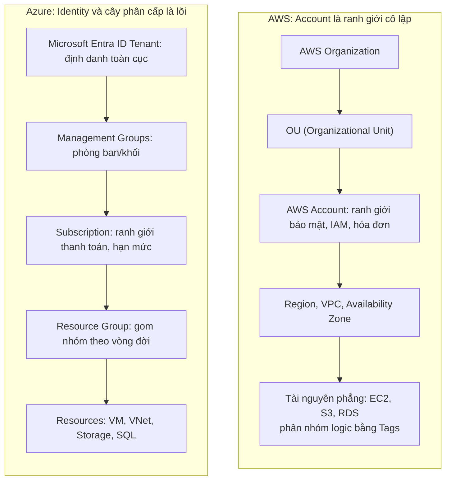
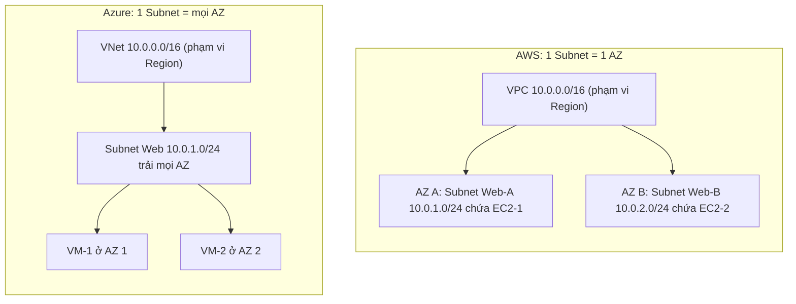
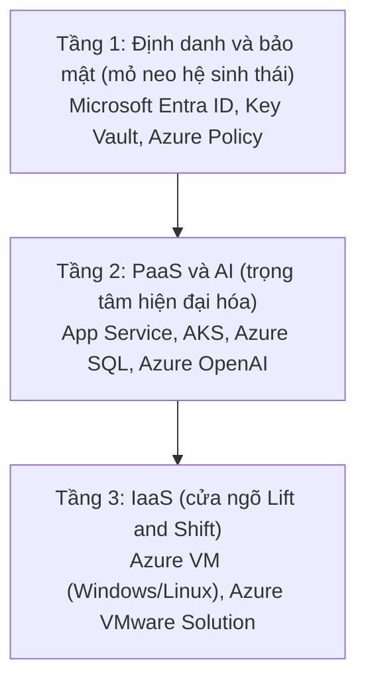
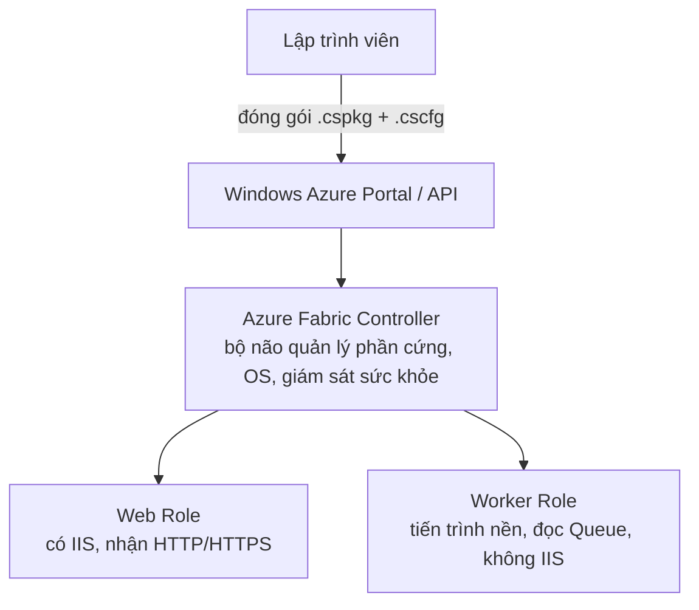

# Azure so với AWS: triết lý thiết kế, mô hình tài nguyên và lịch sử

Azure và AWS tổ chức tài nguyên khác nhau vì xuất phát từ hai tệp khách hàng khác nhau. Tài liệu này giải thích sự khác biệt về cấu trúc quản trị, mạng (subnet và Availability Zone), nhóm tài nguyên chủ lực, và lý do lịch sử: Azure ra đời năm 2010 như một nền tảng PaaS thuần rồi phải bẻ lái sang IaaS.

Lý do doanh nghiệp stack Microsoft (Windows Server, SQL Server) thường chọn Azure về mặt bản quyền nằm ở file `licensing-and-cloud-lock-in.md`.

## 1. Hai "gen" thiết kế

AWS xây từ dưới lên (bottom-up) cho các nhóm kỹ sư phần mềm độc lập. Azure thiết kế từ trên xuống (top-down) để mô phỏng cấu trúc quản trị của phòng IT doanh nghiệp và Windows Active Directory.

| Khía cạnh | AWS | Azure |
|---|---|---|
| Triết lý | Ra đời từ nhu cầu nội bộ của Amazon.com, giúp các "two-pizza team" tự tạo hạ tầng qua API không cần xin phép bộ phận vận hành trung tâm. AWS Account là hộp kín độc lập về bảo mật, định danh, thanh toán. | Sinh ra để bán cho CIO đã quen ký hợp đồng tổng (Enterprise Agreement), nên cấu trúc phản ánh sơ đồ tổ chức công ty từ trên xuống để chia ngân sách và kiểm soát tập trung. |
| Định danh | IAM nằm trong từng Account. Về sau mới bổ sung AWS IAM Identity Center để đăng nhập tập trung. | Microsoft Entra ID (tiền thân Azure AD) ở tầng cao nhất, bao trùm mọi Subscription, giống một hệ thống Active Directory duy nhất cho mọi nhân viên. |
| Nhóm tài nguyên | Không có khái niệm tương đương. Tài nguyên nằm phẳng trong Region của Account. Muốn nhóm hay chia chi phí thì dùng Tags hoặc tách sang Account khác. | Resource Group, tương tự OU trong Active Directory hoặc Folder trong vCenter: gom thành phần của một ứng dụng để phân quyền và quản lý vòng đời. Xóa Resource Group là dọn sạch tài nguyên bên trong. |
| Kế thừa chính sách | AWS Organizations (kèm Service Control Policy, tag policy) áp chính sách theo cây OU và Account. | Cây Management Group - Subscription - Resource Group cho phép Azure Policy và RBAC từ cấp cha chảy xuống mọi tài nguyên con, tương tự Group Policy (GPO) của Windows Server. |

Vì xuất phát từ dưới lên, khi AWS tiến vào thị trường doanh nghiệp lớn họ phải bổ sung AWS Organizations, Control Tower và Landing Zone Accelerator (xem `vmware-on-aws-hybrid-architecture.md`) để có tầng quản trị phân cấp từ trên xuống, thứ vốn nằm sẵn trong DNA của Azure.

Lưu ý chính xác: "mọi tài nguyên Azure đều phải nằm trong một Resource Group" hơi quá tay. Mỗi tài nguyên thuộc đúng một Resource Group, nhưng một số loại tài nguyên tồn tại ở phạm vi Subscription, Management Group hoặc Tenant.

## 2. Mạng: Subnet gắn AZ hay trải mọi AZ

Cả AWS VPC lẫn Azure VNet đều có phạm vi một Region. Khác biệt nằm ở Subnet: Subnet của AWS khóa cứng vào một Availability Zone (AZ), Subnet của Azure mặc định trải qua mọi AZ trong Region.

Bốn hệ quả:

| Hệ quả | AWS | Azure |
|---|---|---|
| Quy hoạch CIDR | HA trên 3 AZ buộc cắt 3 Subnet riêng (10.0.1.0/24, 10.0.2.0/24, 10.0.3.0/24). Dải IP bị phân mảnh, Route Table phức tạp hơn. | Chỉ cần 1 Subnet (10.0.1.0/24). Hai VM ở hai AZ vẫn chung một dải, giống VLAN truyền thống. |
| Vùng chịu lỗi | Nhìn Subnet là biết hệ thống nằm ở AZ nào. Chỉ có 1 Subnet nghĩa là chắc chắn nằm trong 1 AZ. | Vị trí vật lý chuyển sang tầng tài nguyên: chọn AZ khi tạo VM hoặc đĩa. Mạng gọn, nhưng nếu quên tham số AZ, các VM chung Subnet có thể dồn vào cùng một cụm vật lý mà sơ đồ mạng không cho thấy. |
| Định tuyến và chi phí liên AZ | Nhìn IP biết gói tin có sang AZ khác không (10.0.1.x sang 10.0.2.x). | Hai VM cùng Subnet (10.0.1.4 và 10.0.1.5) có thể ở hai AZ khác nhau, lưu lượng vẫn đi qua đường liên AZ và chịu độ trễ tương ứng. |
| NAT Gateway, Load Balancer | NAT Gateway nằm trong một Subnet (một AZ). Khuyến nghị cổ điển: mỗi AZ một NAT Gateway và Route Table riêng. | Xem mục "NAT Gateway" bên dưới. Mô tả "một NAT phục vụ mọi AZ" trong nguồn gốc không đúng với SKU Standard. |

### NAT Gateway: nguồn gốc nói sai về Azure

- **AWS zonal NAT:** AWS nói "you can improve resiliency by creating a NAT gateway in each Availability Zone", nên mô hình "mỗi AZ một NAT" vẫn đúng.
- **AWS regional NAT (mới):** AWS ra mắt regional NAT gateway tháng 11/2025, tạo bằng `--availability-mode regional`, tự mở rộng và co lại qua các AZ, không cần public subnet. Mở rộng sang AZ mới có thể mất tới 60 phút, và không hỗ trợ private NAT. Với thiết kế mới, "mỗi AZ một NAT" không còn là mẫu duy nhất.
- **Azure NAT Gateway Standard:** là tài nguyên zonal, triển khai vào một AZ hoặc "No zone" (Azure tự đặt). Không phải dịch vụ phục vụ mọi AZ của Subnet.
- **Azure NAT Gateway StandardV2:** zone-redundant, hoạt động xuyên mọi AZ của Region. Cần public IP StandardV2, không có ở một số Region (Canada East, India South Central, Sweden South, West India), và không nâng cấp trực tiếp từ Standard.

### Chi phí liên AZ

- **Azure:** không tính phí truyền dữ liệu giữa các AZ trong cùng Region, dù dùng IP private hay public. Các trang bên thứ ba còn ghi $0.01/GB cho Azure là đã lỗi thời.
- **AWS:** có tính phí truyền dữ liệu liên AZ. Mức $0.01/GB mỗi chiều chỉ có từ nguồn thứ cấp, cần đối chiếu trang giá EC2 chính thức trước khi dùng con số.

## 3. Tài nguyên chủ lực của Azure

Azure VM là tài nguyên IaaS phổ biến nhất để đưa hệ thống cũ lên nhanh, nhưng trọng tâm chiến lược nằm ở PaaS và định danh.

- **Azure VM (IaaS):** gánh phần lớn khối lượng giai đoạn đầu Lift-and-Shift (Windows Server, ERP cũ), nhờ Azure Hybrid Benefit. Microsoft coi đây là bước đệm.
- **App Service và AKS (PaaS và container):** thay vì thuê VM rồi tự cài IIS/Nginx và vá OS, hệ thống web và API hiện đại (nhất là .NET, Java, Node.js) chạy trên App Service hoặc AKS cho microservices.
- **Azure SQL Database và Cosmos DB:** bản PaaS thay vì cài SQL Server lên VM. Có tier serverless tự tạm dừng khi không có truy vấn (chỉ tính phí lưu trữ). Chi tiết giới hạn bản quyền nằm ở `licensing-and-cloud-lock-in.md`.
- **Microsoft Entra ID và Azure OpenAI:** Entra ID nối hạ tầng cloud với Microsoft 365 và tài khoản nhân viên. Azure OpenAI hỗ trợ private endpoint trong VNet và có cam kết riêng về dữ liệu (prompt và completion không dùng cho khách khác hay OpenAI, không dùng để huấn luyện model nền khi chưa có phép). Đây là cam kết bảo vệ dữ liệu theo Microsoft Data Protection Addendum, chứ không phải một "gói enterprise" riêng. Global và DataZone deployment có thể xử lý dữ liệu ngoài vùng địa lý của bạn.

Theo thời gian, doanh nghiệp trên Azure thường bắt đầu bằng chi phí VM lớn nhất, rồi dịch chuyển dần sang App Service, AKS và Azure SQL để giảm chi phí quản trị OS và tận dụng co giãn.

## 4. Lịch sử: Azure khởi đầu là PaaS thuần

AWS khởi đầu bằng hạ tầng thô (EC2, S3). Azure đi hướng ngược lại.

| Mốc | Sự kiện |
|---|---|
| 27/10/2008 | Công bố Windows Azure tại PDC 2008, Ray Ozzie giữ chức chief software architect. Dave Cutler (tác giả nhân Windows NT) cùng Amitabh Srivastava dẫn dắt dự án nội bộ "Red Dog". |
| 01/02/2010 | Windows Azure ra mắt thương mại (GA), cùng SQL Azure, tại 21 quốc gia. |
| 07/06/2012 | Bản bổ sung VM bền vững (Linux có trong gallery). |
| 16/04/2013 | Azure Virtual Machines (IaaS) GA. |
| 03/04/2014 | Đổi tên Windows Azure thành Microsoft Azure (công bố 25/03/2014, hiệu lực 03/04/2014). |

Giai đoạn 2010-2011, mô hình chính là Cloud Services: lập trình viên chỉ viết code, đóng gói thành `.cspkg` (code) cùng `.cscfg` (cấu hình số instance, biến môi trường) rồi tải lên cổng quản trị. Nền tảng không cho tạo VM thông thường.

- **Web Role:** môi trường dựng sẵn IIS và Load Balancer phía trước để nhận lưu lượng web/API.
- **Worker Role:** môi trường chạy nền thuần túy (không IIS) cho tác vụ bất đồng bộ như đọc Queue, xử lý ảnh/video.
- **Fabric Controller:** quản lý vòng đời ứng dụng và giám sát sức khỏe phần cứng.
- **Stateless tuyệt đối:** ghi lên đĩa cục bộ của role VM là không bền vững, bảo trì có thể re-image toàn bộ.

### Vì sao phải bẻ lái sang IaaS?

| Rào cản | Giải thích |
|---|---|
| Không Lift-and-Shift được | ERP, SharePoint và ứng dụng ghi file xuống `C:\` hoặc giữ session trong bộ nhớ máy chủ không chạy được trong môi trường stateless nếu không viết lại. |
| Deploy chậm | Mỗi lần cập nhật phải đóng gói, cấp phát và khởi động lại môi trường (nguồn gốc nói 15-30 phút, chưa xác minh). |
| Đóng kín trong hệ sinh thái Windows | Đời đầu tập trung .NET và Windows Server, đẩy cộng đồng Linux, Java, PHP sang AWS. |
| Sức hút của EC2 | AWS đưa ra VM trống cài gì cũng chạy ngay, trong khi Azure đòi viết lại ứng dụng theo chuẩn Cloud Services. |

### Di sản và tình trạng hiện nay

- Cloud Services (classic) bị ngừng cho mọi khách hàng từ 01/09/2024.
- Cloud Services (extended support), bản kế nhiệm dựa trên Azure Resource Manager, cũng đã bị Microsoft deprecate từ 31/03/2025 và sẽ nghỉ hẳn ngày 31/03/2027. Microsoft hiện hướng khách sang Service Fabric managed clusters, App Service, AKS, Container Apps và Virtual Machine Scale Sets.
- Service Fabric có nguồn gốc chính thức: Microsoft tạo ra cho chính cloud của mình, đã chạy production hơn năm năm khi GA năm 2016 (Azure SQL Database, DocumentDB, Intune, Cortana, Skype for Business). Quan hệ kế thừa trực tiếp "Web Role/Worker Role thành App Service và Service Fabric" như nguồn gốc nói không được Microsoft xác nhận ở trang chính thức nào, nên chỉ nên hiểu là các hướng được khuyến nghị thay thế Cloud Services.

## Kiểm chứng

Đối chiếu với nguồn chính thức, ngày 2026-11-18.

| Điểm | Kết quả | Nguồn |
|---|---|---|
| Azure GA ngày 01/02/2010 | Đúng. Trang 2010 không nhắc Red Dog hay "PaaS". | [Microsoft blog](https://blogs.microsoft.com/blog/2010/02/01/windows-azure-general-availability/#:~:text=We%20are%20announcing%20the%20general%20availability%20of%20Windows%20Azure) |
| Ray Ozzie, Dave Cutler, Red Dog | Đúng. | [Microsoft features](https://news.microsoft.com/features/the-engineers-engineer-computer-industry-luminaries-salute-dave-cutlers-five-decade-long-quest-for-quality/) (fragment unverified) |
| Đổi tên Microsoft Azure, hiệu lực 03/04/2014 | Đúng. | [Azure blog](https://azure.microsoft.com/en-us/blog/upcoming-name-change-for-windows-azure/#:~:text=Windows%20Azure%20will%20be%20renamed%20to%20Microsoft%20Azure%2C%20beginning%20April%203%2C%202014) |
| Cloud Services (classic) ngừng 01/09/2024 | Đúng. | [Microsoft Learn](https://learn.microsoft.com/en-us/azure/cloud-services/cloud-services-choose-me#:~:text=Cloud%20Services%20(classic)%20is%20now%20deprecated%20for%20all%20customers%20as%20of%20September%201st%2C%202024) |
| Cloud Services (extended support) nghỉ 31/03/2027 | Đúng. | [Microsoft Learn](https://learn.microsoft.com/en-us/azure/cloud-services-extended-support/overview#:~:text=fully%20retired%20on%20March%2031%2C%202027) |
| Service Fabric hiện vận hành nhiều dịch vụ Microsoft | Đúng. | [Microsoft Learn](https://learn.microsoft.com/en-us/azure/service-fabric/service-fabric-overview#:~:text=Service%20Fabric%20powers%20many%20Microsoft%20services%20today) |
| Mỗi tài nguyên thuộc đúng một Resource Group | Đúng, nhưng có loại tài nguyên ở phạm vi cao hơn. | [Microsoft Learn](https://learn.microsoft.com/en-us/azure/azure-resource-manager/management/overview#:~:text=Each%20resource%20can%20exist%20in%20only%20one%20resource%20group) |
| Azure AD đổi tên Entra ID (công bố 11/07/2023) | Đúng. | [Microsoft Learn](https://learn.microsoft.com/en-us/entra/fundamentals/new-name#:~:text=The%20name%20changes%20were%20publicly%20announced%20on%20July%2011%2C%202023) |
| AWS account là ranh giới quyền, bảo mật, chi phí, workload | Đúng. | [AWS Organizations](https://docs.aws.amazon.com/organizations/latest/userguide/orgs_introduction.html#:~:text=AWS%20accounts%20are%20natural%20boundaries%20for%20permission%2C%20security%2C%20costs%2C%20and%20workloads) |
| AWS khuyến nghị Control Tower làm nền cho LZA | Đúng. | [LZA overview](https://docs.aws.amazon.com/solutions/latest/landing-zone-accelerator-on-aws/solution-overview.html#:~:text=We%20recommend%20customers%20deploy%20AWS%20Control%20Tower%20as%20the%20foundational%20landing%20zone) |
| Subnet AWS nằm trọn trong một AZ | Đúng. | [AWS VPC](https://docs.aws.amazon.com/vpc/latest/userguide/configure-subnets.html#:~:text=Each%20subnet%20must%20reside%20entirely%20within%20one%20Availability%20Zone) |
| VNet và Subnet Azure trải mọi AZ | Đúng. | [Microsoft Learn](https://learn.microsoft.com/en-us/azure/virtual-network/virtual-networks-overview#:~:text=Virtual%20networks%20and%20subnets%20span%20all%20availability%20zones%20in%20a%20region) |
| AWS: "mỗi AZ một NAT" để tăng khả năng chịu lỗi | Đúng. | [AWS VPC](https://docs.aws.amazon.com/vpc/latest/userguide/nat-gateway-scenarios.html#:~:text=you%20can%20improve%20resiliency%20by%20creating%20a%20NAT%20gateway%20in%20each%20Availability%20Zone) |
| AWS regional NAT gateway | Đúng, ra mắt 11/2025. | [AWS VPC](https://docs.aws.amazon.com/vpc/latest/userguide/nat-gateways-regional.html#:~:text=A%20regional%20NAT%20gateway%20automatically%20expands%20across%20Availability%20Zones) |
| Azure NAT Standard là zonal | Đúng, nguồn gốc nói sai. | [Microsoft Learn](https://learn.microsoft.com/en-us/azure/nat-gateway/nat-overview#:~:text=Standard%20is%20zonal%20(deployed%20to%20a%20single%20availability%20zone)) |
| Azure NAT StandardV2 là zone-redundant | Đúng. | [Microsoft Learn](https://learn.microsoft.com/en-us/azure/nat-gateway/nat-overview#:~:text=StandardV2%20is%20zone%20redundant) |
| Azure không tính phí truyền dữ liệu liên AZ | Đúng. | [Microsoft Learn](https://learn.microsoft.com/en-us/azure/reliability/availability-zones-overview#:~:text=Azure%20doesn't%20charge%20for%20data%20transfer%20between%20availability%20zones%20in%20the%20same%20region) |
| Quy tắc "two-pizza team" | Có trong whitepaper AWS, trích Bezos, không có nguồn gốc hay ngày gốc. | [AWS whitepaper](https://docs.aws.amazon.com/whitepapers/latest/introduction-devops-aws/communication-collaboration.html#:~:text=We%20try%20to%20create%20teams%20that%20are%20no%20larger%20than%20can%20be%20fed%20by%20two%20pizzas) |
| Azure OpenAI hỗ trợ private endpoint | Đúng. | [Microsoft Learn](https://learn.microsoft.com/en-us/azure/foundry-classic/openai/how-to/network#:~:text=Private%20endpoint%20connections%20will%20be%20the%20exclusive%20way%20to%20access%20this%20resource) |
| Azure OpenAI không chia sẻ prompt cho khách khác | Đúng. | [Microsoft Learn](https://learn.microsoft.com/en-us/azure/foundry/responsible-ai/openai/data-privacy#:~:text=are%20NOT%20available%20to%20other%20customers) |

Chưa xác minh được:

- Nhận định Azure khởi đầu là "PaaS thuần, không có nút Create VM" không được trang Microsoft nào thời 2010 khẳng định trực tiếp. Căn cứ gián tiếp là trang Cloud Services (gọi nó là PaaS, "không phải IaaS") và bài tháng 6/2012 bổ sung VM bền vững.
- Con số "deploy mất 15-30 phút" và "chỉ hỗ trợ .NET và Windows Server ở đời đầu" chưa được kiểm tra.
- Phí liên AZ của AWS ($0.01/GB mỗi chiều) chưa lấy được từ trang giá chính thức.
- Ngày GA của Service Fabric năm 2016 lấy từ bản tóm tắt trang, chưa xác minh fragment.
- Các câu về "Entra ID bao trùm mọi Subscription" và "root management group ID trùng Entra tenant ID" là cách diễn đạt của trang quản trị tài nguyên Azure và nguồn gốc, chưa kiểm tra chi tiết các trường hợp nhiều tenant.
