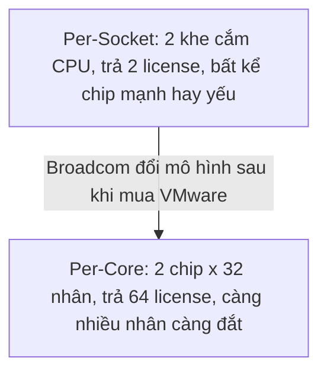
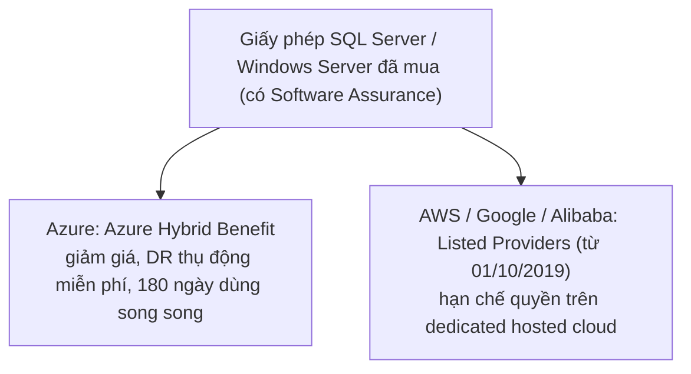

# Bản quyền phần mềm và khóa chặt đám mây

Cách các hãng phần mềm tính bản quyền (theo nhân CPU, theo edition, theo nhà cung cấp cloud) quyết định phần lớn chi phí và độ linh hoạt khi đưa hệ thống lên cloud. Tài liệu đi từ khái niệm per-core (VMware) sang SQL Server trên cloud, chiến lược bản quyền của Microsoft, rồi lý do doanh nghiệp stack Windows thường chọn Azure.

Tài liệu này tổng hợp thông tin kỹ thuật, không phải tư vấn pháp lý. Mọi quyết định mua, gia hạn hoặc di chuyển bản quyền cần xác nhận với bộ phận licensing/legal nội bộ và đối chiếu Product Terms hiện hành của Microsoft hoặc báo giá bằng văn bản của Broadcom.

## 1. Bản quyền tính theo nhân CPU (per-core)

Per-core nghĩa là hãng đếm tổng số nhân vật lý (physical cores) trên toàn bộ máy chủ cài phần mềm, nhân với đơn giá thuê bao hằng năm, bất kể bạn chạy bao nhiêu VM hay dùng hết công suất hay không.

| | Cách cũ (per-socket) | Cách mới (per-core) |
|---|---|---|
| Đơn vị tính | Số chip vật lý trên mainboard | Số nhân vật lý bên trong chip |
| Máy 2 CPU, mỗi CPU 32 nhân | 2 license | 64 license |
| Hình thức | License vĩnh viễn | Thuê bao hằng năm |

### VMware sau khi Broadcom tiếp quản

- Broadcom ngừng bán perpetual license và chuyển sang thuê bao VCF/VVF tính trên tổng số nhân vật lý.
- Mức sàn chính thức: phải license tối thiểu 16 nhân vật lý cho mỗi CPU, nên máy chip đời cũ chỉ 8 nhân vẫn trả 16 nhân (Broadcom KB 313548).
- Broadcom không công bố giá niêm yết. Mức khoảng $350 mỗi nhân mỗi năm cho VCF chỉ là "reported list price" của một nhà tư vấn (AceMQ, cập nhật 27/10/2026), không nêu nguồn gốc, nên coi là không chính thức. Báo giá thực tế dao động theo thời hạn (cùng nguồn đó dẫn các báo giá một năm khoảng $344 và ba năm khoảng $257-348).
- Một mức tối thiểu 72 nhân mỗi đơn hàng được báo chí đưa tin vào tháng 4/2025 (qua nhà phân phối Arrow, The Register, Heise), các nguồn không thống nhất là đã rút lại hay chưa. KB của Broadcom chỉ nhắc mức sàn 16 nhân mỗi CPU.

Ví dụ minh họa, dùng mức $350 chưa chính thức: một máy 2 CPU, mỗi CPU 32 nhân, tổng 64 nhân, tốn 64 x 350 = $22.400 mỗi năm chỉ riêng phần mềm. Cụm 10 máy là $224.000 mỗi năm. Chưa tính phần cứng, điện, chỗ đặt.

### Vì sao các hãng chuyển sang per-core?

Chip mới (AMD EPYC, Intel Xeon) giữ 1-2 socket nhưng nhồi 64, 96, thậm chí 128 nhân. Giữ per-socket thì một máy 128 nhân thay 4 máy cũ sẽ cắt 75% tiền bản quyền. Vì vậy Broadcom, Microsoft (Windows Server, SQL Server) và Oracle đều tính theo nhân để chi phí tăng tỷ lệ với sức mạnh tính toán.

- Microsoft SQL Server: tối thiểu 4 core license cho mỗi bộ xử lý vật lý, và tối thiểu 4 core license cho mỗi VM.
- Windows Server dùng mức sàn riêng (8 core license mỗi CPU và 16 mỗi server theo mô hình core, 8 core license mỗi VM với Azure Hybrid Benefit), đừng nhầm với mức sàn 4 của SQL Server.
- Oracle: processor license = số nhân nhân với core factor, làm tròn lên (Intel Xeon và AMD EPYC thường 0.5). Chỉ có từ nguồn thứ cấp vì trang chính thức của Oracle chặn truy cập, cần đối chiếu trực tiếp. Bảng core factor không áp dụng trên AWS hay Azure, nơi hai vCPU có hyper-threading tính là một processor license.

## 2. Vì sao SQL Server khó linh hoạt trên Cloud

Rào cản bản quyền biến SQL Server thành "khối bê tông" khó co giãn trên cloud, đối lập với PostgreSQL và MySQL.

| Cơ chế | Chi tiết đã kiểm chứng | Điểm chưa xác minh |
|---|---|---|
| Chi phí bản quyền đè lên auto-scaling | Amazon RDS for SQL Server License Included tính phí bản quyền cộng vào giá instance. AWS ghi: "Microsoft charges for a minimum of 4 vCPUs for SQL Server licenses". Đây là mức tính phí bản quyền tối thiểu cho instance từ 4 vCPU trở xuống, không phải sàn kích thước instance. Instance Standard vẫn bắt đầu từ 2 vCPU. | Tỷ lệ "bản quyền chiếm 60%-80% hóa đơn" không có nguồn chính thức. Với các dòng instance tách giá (M7i, R7i, M8i...), trang giá tính riêng instance và license theo vCPU-giờ, nên có thể tự tính từ Price List API. |
| Nấc cấu hình theo edition | Standard bị giới hạn ở "lesser of 4 sockets or 24 cores" và 128 GB buffer pool mỗi instance. Enterprise giới hạn bằng mức tối đa của OS. | Việc lên Enterprise làm đơn giá "gấp 3-4 lần" là ước lượng, chưa xác minh với bảng giá hiện hành. |
| Hạn chế mang license cũ lên hạ tầng dùng chung | Xem mục 3. Nguồn gốc nói "chỉ được dùng trên Dedicated Host" là chưa chính xác. | |
| Không có serverless thực thụ | Amazon Aurora Serverless v2 hỗ trợ scale về 0 ACU và tự tạm dừng từ 20/11/2024, nhưng chỉ cho Aurora MySQL và PostgreSQL. Trang giá và tài liệu instance class của RDS for SQL Server chỉ liệt kê các lớp provisioned, không có tùy chọn serverless. | "Không có serverless" là suy ra từ việc không thấy tài liệu, chưa phải câu khẳng định chính thức của AWS. |

Hệ quả thực tế: trong các dự án Cloud Modernization, ưu tiên thường là chuyển dữ liệu từ SQL Server hoặc Oracle sang PostgreSQL, nơi co giãn hàng trăm nhân, dựng cụm đọc/ghi phân tán hoặc chạy serverless không bị ràng buộc giấy phép. Đây là nhận định kiến trúc, không phải sự kiện có nguồn.

## 3. Bản quyền như một "con hào kinh tế" của Microsoft

Cùng một giấy phép SQL Server có Software Assurance (SA), cách đối xử giữa các cloud khác nhau.

### Luật "Listed Providers"

- Từ 01/10/2019, Microsoft liệt Alibaba, Amazon (kể cả VMware Cloud on AWS), Google và chính Microsoft vào nhóm Listed Providers.
- Điều bị hạn chế: license mua tại chỗ mà không có SA và quyền license mobility không được triển khai lên dịch vụ cloud dedicated hosted của các nhà cung cấp này. Không thể thêm workload mới theo license mua từ ngày đó. License cũ hơn được giữ nguyên quyền (grandfathered).
- Điều nguồn gốc nói sai: "bắt buộc thuê Dedicated Host hoặc Bare Metal mới dùng lại được giấy phép" không đúng. Quyền license mobility qua SA áp dụng trên máy chủ dùng chung (Azure IaaS và AWS EC2). Không có SA thì license mua sau 10/2019 không đưa lên dedicated host được.
- Azure Arc ghi thêm: unlimited virtualization không khả dụng trên hạ tầng của Listed Provider.

### Azure Hybrid Benefit (AHB)

| Quyền lợi | Kết quả kiểm chứng |
|---|---|
| Mức giảm giá | Con số khác nhau theo nguồn và thời điểm. Trang Partner Center cũ: "up to 40%" cho Azure VM, "up to 55%" cho SQL, tối đa 80% khi kết hợp reservation. Trang AHB hiện hành: tới 80% (Windows) và 85% (SQL) so với pay-as-you-go. Tài liệu Azure SQL Database: "up to 30 percent or more". Coi là con số "tối đa", thay đổi theo workload và vùng. |
| Bản sao dự phòng thụ động miễn phí | Đúng, cho license có SA hoặc pay-as-you-go: "free passive instances of SQL Server for high availability and disaster recovery". |
| Dùng song song tại chỗ và trên Azure | Đúng: 180 ngày cho phép di chuyển, sau đó license chỉ dùng trên Azure. Áp dụng cả Windows Server và SQL Server theo trang AHB. |
| Dùng cho Azure SQL Database serverless | Không đúng như nguồn gốc nói. Microsoft ghi AHB "doesn't apply to the DTU-based purchasing model or the serverless compute tier" và chỉ khả dụng với provisioned compute tier. Serverless tier vẫn tự tạm dừng khi không hoạt động (chỉ tính phí lưu trữ), tối thiểu 15 phút trễ tạm dừng ở General Purpose. |

### Vụ kiện CISPE

- CISPE (liên minh các hãng cloud châu Âu) nộp đơn khiếu nại lên Ủy ban châu Âu vào 11/2022 về cách Microsoft cấp phép phần mềm.
- Ngày 11/07/2024, CISPE và Microsoft công bố thỏa thuận: CISPE rút đơn và cam kết không khởi xướng hay ủng hộ khiếu nại mới về các vấn đề này. Microsoft trả một khoản "lump-sum contribution" bù chi phí kiện tụng và vận động trong ba năm, và có chín tháng để đưa ra phiên bản Azure Stack HCI nâng cấp cho các nhà cung cấp hosting châu Âu, do European Cloud Observatory giám sát độc lập. Thỏa thuận không bao gồm AWS hay Google.
- Số tiền: thông cáo chính thức không nêu con số. Báo chí (Reuters, Tech Monitor, DCD) đưa mức khoảng 20 triệu euro (khoảng 21,7 triệu USD). Nguồn gốc nói "hàng trăm triệu USD" là sai, không có căn cứ.

## 4. Vì sao doanh nghiệp stack Windows thường chọn Azure

Ngoài chuyện bản quyền như SQL Server ở trên, hệ Windows Server còn gắn với Azure qua định danh và vòng đời bảo mật.

| Yếu tố | Nội dung |
|---|---|
| Azure Hybrid Benefit cho Windows Server | Tái dùng license Windows Server (Datacenter có SA) trên Azure, tối thiểu 8 core license mỗi VM. Cho phép chạy song song tại chỗ và trên Azure 180 ngày để di chuyển. |
| Extended Security Updates (ESU) miễn phí trên Azure | Windows Server 2012 và 2012 R2 đã hết hỗ trợ thường. Trên Azure (VM, Azure VMware Solution, Azure Stack HCI, Dedicated Host) ESU miễn phí, ngoài Azure phải mua. Bảng của Microsoft Learn ghi ngày kết thúc là 13/10/2026 cho cả Azure và ngoài Azure, tức đã qua vào thời điểm viết (18/11/2026), nên "tặng thêm 3 năm" trong nguồn gốc đã hết hạn. Cần xác nhận trực tiếp với Microsoft nếu còn hệ thống 2012. |
| Active Directory và Microsoft 365 | Đa số công ty Windows lấy Active Directory làm gốc tài khoản. Nối AD tại chỗ lên Microsoft Entra ID để SSO với Outlook, Teams và phân quyền Azure gần như tự động, ít công cấu hình cầu nối xác thực hơn khi sang AWS IAM. Đây là nhận định kiến trúc, chưa có nguồn chính thức so sánh trực tiếp. |
| Azure Arc | Quản lý máy chủ tại chỗ và trên Azure trên một màn hình, dùng công cụ quen thuộc của SysAdmin Windows (Group Policy, Windows Admin Center). Azure Arc chiếu tài nguyên ngoài Azure vào Azure Resource Manager. |

Doanh nghiệp stack Microsoft thuần (Windows Server, SQL Server, .NET, Office 365) thường chỉ cân nhắc AWS hoặc GCP khi quyết tâm tái cấu trúc sang Linux và mã nguồn mở. Nếu mục tiêu là lên mây nhanh và rẻ nhất mà giữ hiện trạng thì Azure gần như là mặc định. Đây là kết luận suy ra từ các yếu tố trên.

Về cấu trúc quản trị của Azure (Entra ID, Management Group, Subscription) xem `azure-vs-aws-design-and-history.md`. Về VMware trên AWS và Broadcom xem `vmware-on-aws-hybrid-architecture.md`.

## Kiểm chứng

Đối chiếu với nguồn chính thức, ngày 2026-11-18.

| Điểm | Kết quả | Nguồn |
|---|---|---|
| Mức sàn 16 nhân mỗi CPU của VMware | Đúng. | [Broadcom KB 313548](https://knowledge.broadcom.com/external/article/313548/counting-cores-for-vmware-cloud-foundati.html#:~:text=minimum%20of%2016%20physical%20cores%20for%20each%20CPU) |
| Giá khoảng $350 mỗi nhân mỗi năm | Không chính thức, chỉ là "reported list price". | [AceMQ](https://acemq.com/blogs/vcf-licensing-explained/#:~:text=Reported%20list%20price%20is%20%24350%20per%20core%20per%20year) |
| SQL Server Standard giới hạn 4 socket hoặc 24 nhân và 128 GB | Đúng (kiểm tra trang SQL Server 2022). | [Microsoft Learn](https://learn.microsoft.com/en-us/sql/sql-server/editions-and-components-of-sql-server-2022?view=sql-server-ver17#:~:text=Limited%20to%20lesser%20of%204%20sockets%20or%2024%20cores) |
| Tối thiểu 4 core license mỗi bộ xử lý hoặc VM | Đúng. | [Microsoft Licensing](https://www.microsoft.com/licensing/guidance/Core-based-licensing-models) (fragment unverified) |
| RDS for SQL Server tính tối thiểu 4 vCPU | Đúng, là phí bản quyền chứ không phải sàn kích thước instance. | [AWS RDS docs](https://docs.aws.amazon.com/AmazonRDS/latest/UserGuide/SQLServer.Concepts.General.InstanceClasses.html#:~:text=Microsoft%20charges%20for%20a%20minimum%20of%204%20vCPUs%20for%20SQL%20Server%20licenses) |
| Listed Providers, hiệu lực 01/10/2019 | Đúng, nhưng phạm vi hạn chế hẹp hơn nguồn gốc nói. | [Microsoft Licensing](https://www.microsoft.com/licensing/news/updated-licensing-rights-for-dedicated-cloud#:~:text=Microsoft%2C%20Alibaba%2C%20Amazon) (fragment unverified) |
| License mobility qua SA trên Azure IaaS và AWS EC2 | Đúng. | [Microsoft Learn](https://learn.microsoft.com/en-us/azure/azure-sql/azure-hybrid-benefit?view=azuresql#:~:text=You%20can%20use%20this%20benefit%20on%20Azure%20IaaS%20and%20AWS%20EC2.) |
| AHB không áp dụng cho serverless tier | Đúng, nguồn gốc nói ngược lại. | [Microsoft Learn](https://learn.microsoft.com/en-us/azure/azure-sql/azure-hybrid-benefit?view=azuresql#:~:text=doesn't%20apply%20to%20the) |
| Serverless tier tự tạm dừng | Đúng. | [Microsoft Learn](https://learn.microsoft.com/en-us/azure/azure-sql/database/serverless-tier-overview?view=azuresql#:~:text=also%20automatically%20pauses%20databases%20during%20inactive%20periods) |
| Bản sao DR thụ động miễn phí | Đúng. | [Microsoft Learn](https://learn.microsoft.com/en-us/sql/sql-server/azure-arc/manage-license-billing?view=sql-server-ver17#:~:text=free%20passive%20instances%20of%20SQL%20Server%20for%20high%20availability%20and%20disaster%20recovery) |
| Mức giảm giá "up to 40%" (Partner Center) | Là cách ghi cũ, trang hiện hành ghi con số khác. | [Microsoft Learn](https://learn.microsoft.com/en-us/partner-center/customers/azure-ri-server-subscriptions#:~:text=save%20up%20to%2040%25) |
| ESU Windows Server miễn phí trên Azure, ngày kết thúc | Đúng, ngày 13/10/2026 đã qua. | [Microsoft Learn](https://learn.microsoft.com/en-us/windows-server/get-started/extended-security-updates-overview#:~:text=Extended%20Security%20Updates%20for%20Windows%20Server%20include) |
| Aurora Serverless v2 scale về 0 ACU, từ 20/11/2024 | Đúng. | [AWS What's New](https://aws.amazon.com/about-aws/whats-new/2024/11/amazon-aurora-serverless-v2-scaling-zero-capacity#:~:text=now%20supports%20scaling%20to%200%20Aurora%20Capacity%20Units) |
| Thỏa thuận CISPE và Microsoft, 11/07/2024 | Đúng, thông cáo không nêu số tiền. | [CISPE](https://www.cispe.cloud/cispe-and-microsoft-agree-settlement-in-fair-software-licensing-case/#:~:text=Microsoft%20will%20pay%20a%20lump%2Dsum%20contribution%20to%20CISPE) |
| Oracle core factor | Chỉ từ nguồn thứ cấp, trang chính thức bị chặn. | [Oracle](https://www.oracle.com/us/corporate/contracts/processor-core-factor-table-070634.pdf) (không truy cập được, fragment unverified) |

Chưa xác minh được:

- Tỷ lệ bản quyền 60%-80% trong hóa đơn RDS for SQL Server.
- Giá Enterprise gấp 3-4 lần Standard.
- Số tiền thực của khoản dàn xếp CISPE (chỉ có ước lượng báo chí khoảng 20 triệu euro).
- Việc AWS không có serverless cho SQL Server, chỉ có bằng chứng ngầm là không thấy trong tài liệu.
- Mức tối thiểu 72 nhân mỗi đơn hàng của VMware có còn hiệu lực hay không.
- Một nguồn thứ ba có ghi một bản cập nhật ngoài chu kỳ (KB5135580, 06/11/2026) liên quan đến Windows Server mà chưa giải thích được, nên cần xác nhận trạng thái ESU hiện tại trực tiếp với Microsoft trước khi quyết định.
