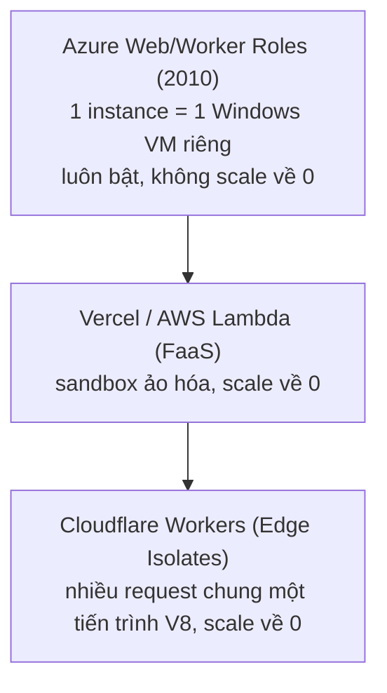
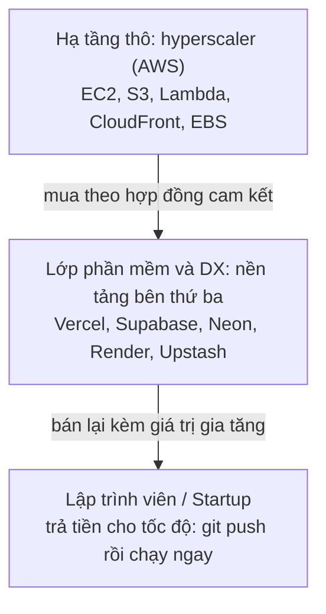
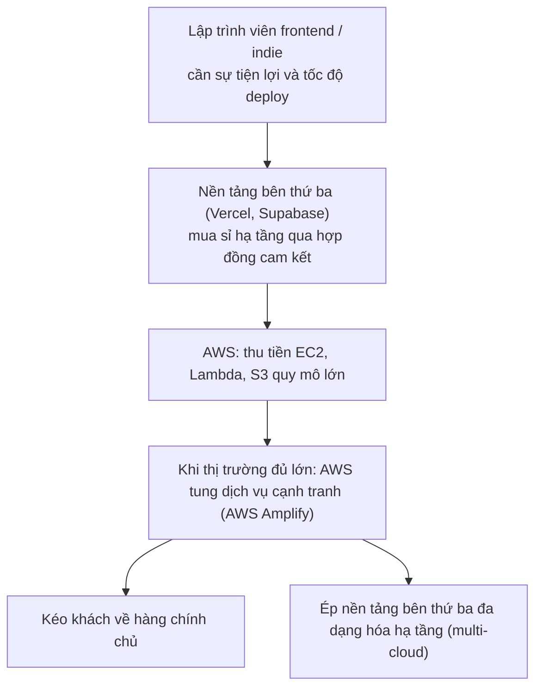

# Serverless và mô hình Cloud Wrapper

Tài liệu gồm hai phần liên quan. Phần đầu so sánh ba thế hệ đơn vị thực thi serverless: Web/Worker Role của Azure (2010), hàm serverless kiểu Vercel/Lambda và Cloudflare Workers. Phần sau phân tích mô hình các công ty bên thứ ba "bọc" hạ tầng của AWS (Vercel, Supabase, Neon...) và mối quan hệ cạnh tranh lẫn hợp tác với AWS.

Chi tiết kỹ thuật của Firecracker và V8 Isolates nằm ở `virtualization-stack-vmware-kvm-firecracker.md`. Lịch sử Web Role và Worker Role nằm ở `azure-vs-aws-design-and-history.md`.

## 1. Web/Worker Role là "tổ tiên" của serverless hiện đại

Về triết lý lập trình, Web Role và Worker Role (PaaS 1.0) giống các nền tảng serverless hiện đại: lập trình viên đẩy code lên, không chạm OS, và buộc phải thiết kế ứng dụng phi trạng thái (stateless). Khác biệt nằm ở hạ tầng bên dưới.

### Những điểm giống nhau

- **Không quản trị OS (No-Ops):** nhà cung cấp giấu máy chủ vật lý, tự vá lỗi và dựng sẵn load balancer phía trước.
- **Bắt buộc stateless:** không lưu dữ liệu lâu dài lên đĩa cục bộ. Session, file, database phải đẩy ra dịch vụ ngoài (Blob/S3, Redis/KV, Queue, Database).
- **Tách luồng đồng bộ và bất đồng bộ:** Web Role tương đương hàm Vercel hay Cloudflare Worker thông thường (nhận HTTP, xử lý, trả response). Worker Role tương đương nền tảng chạy tác vụ nền: Cloudflare Queues, Inngest, Trigger.dev, và Vercel Cron.

### Bảng so sánh

| Tiêu chí | Web/Worker Roles (2010) | Vercel Functions | Cloudflare Workers |
|---|---|---|---|
| Đơn vị thực thi | Một Windows VM cho mỗi instance. | Chạy trên AWS Lambda theo Vercel, nhưng Fluid compute cho phép nhiều request dùng chung một instance. | V8 Isolate trong tiến trình dùng chung. |
| Scale về 0 | Không: số VM khai báo cố định, chạy 24/7. | Có (theo mô hình serverless). | Có. |
| Cách tính tiền | Theo giờ chạy từng VM. | Active CPU, provisioned memory và số lần gọi (invocations). Active CPU ngừng tính khi chờ I/O, còn memory vẫn tính theo vòng đời instance. | Số request cộng thời gian CPU thực tế, không tính chờ I/O. |
| Vị trí chạy | Tập trung 1-2 Region. | Mặc định Region `iad1`, chọn Region cho hàm. | Hơn 330 thành phố theo Cloudflare. |
| Giới hạn tiêu biểu | | Mặc định 2 GB bộ nhớ và 1 vCPU, tối đa 4 GB và 2 vCPU (Pro/Enterprise). Thời lượng mặc định 300 giây. | 128 MB mỗi isolate. CPU tối đa 5 phút (mặc định 30 giây) ở gói Paid. |

Lưu ý khi đọc bảng:

- Nguồn gốc mô tả Vercel Functions là "Firecracker MicroVM" và "bọc AWS Lambda". Vercel xác nhận "Vercel Functions run on AWS Lambda", nhưng Fluid compute là một mô hình thực thi riêng (nhiều lần gọi đồng thời trên một instance, bytecode caching, pre-warming), nên gọi nó là "wrapper của Lambda" là đơn giản hóa quá mức. Vercel chỉ khẳng định Firecracker cho Vercel Sandbox.
- Con số cold start trong nguồn gốc (Web/Worker Role 5-15 phút, Vercel 100-500 ms, Cloudflare dưới 5 ms) không có nguồn chính thức so sánh ba bên. Cloudflare nói "zero cold starts" ở marketing hiện tại. Vercel chỉ nói Fluid làm cold start "less frequent and shorter". Không nên trích các con số này như sự kiện.
- Cách tính tiền của AWS Lambda là số request cộng thời lượng theo GB-giây. Từ 01/08/2025 AWS chuẩn hóa tính phí pha INIT cho mọi cấu hình hàm.

Mô hình Web/Worker Roles đi trước thời đại về tư duy lập trình nhưng bị giới hạn bởi công nghệ ảo hóa lúc đó, vẫn phải dùng cả một VM để chạy một đoạn code. Khi đơn vị thực thi co lại từ "cả chiếc máy" xuống microVM rồi isolate, ý tưởng đẩy code lên mà không quan tâm máy chủ mới thực sự bùng nổ. Đây là nhận định lịch sử.

### Các lựa chọn tác vụ nền hiện nay

- **Inngest** và **Trigger.dev:** nền tảng workflow và tác vụ bền vững (durable) với retry và lịch cron.
- **Cloudflare Queues:** gửi và nhận thông điệp với guaranteed delivery, không tính phí băng thông egress.
- **Vercel Cron Jobs:** vẫn có trên mọi gói nhưng tài liệu hiện gọi là "a legacy feature" sẽ chuyển sang Vercel Schedules. Vercel còn liệt kê `waitUntil`, Queues, Workflows, Daemons và Sandbox.

## 2. Mô hình "Cloud Wrapper"

Các công ty bên thứ ba dùng hạ tầng thô của hyperscaler, đắp thêm lớp phần mềm tối ưu trải nghiệm lập trình viên (Developer Experience, DX) rồi bán lại như SaaS.

### Bản chất hạ tầng của từng nền tảng (đã kiểm chứng)

| Nền tảng | Hạ tầng bên dưới | Lớp giá trị gia tăng |
|---|---|---|
| Vercel | Chạy trên AWS Lambda theo blog của Vercel. Bài viết hạ tầng 2023 (đánh dấu "historical") liệt kê S3, SQS, Fargate/EC2, Global Accelerator, EKS và Lambda. | Tích hợp sâu với Next.js, Preview URL cho từng Pull Request, CDN tự cấu hình. Next.js do đội ngũ core làm việc toàn thời gian tại Vercel dẫn dắt. |
| Supabase | Triển khai dự án vào các AWS Region. Tài liệu Supabase không nêu EC2, EBS hay S3, chỉ liệt kê loại đĩa gp3 và io2. | Biến PostgreSQL thành hệ sinh thái giống Firebase: PostgREST sinh REST API từ bảng, Realtime viết bằng Elixir (Phoenix), Auth và Storage. Mã nguồn mở, cho phép tự cài đặt. |
| Neon | Tách compute khỏi storage với safekeeper, pageserver và object storage. Blog cũ nói dữ liệu nóng lưu cục bộ, dữ liệu lạnh trên S3, tài liệu kiến trúc hiện tại chỉ nói "object storage". | Compute tự scale về 0, branching copy-on-write giống Git. Databricks công bố ngày 14/05/2025 đã đồng ý mua Neon, chưa xác nhận được ngày hoàn tất. |
| Render | Không có tài liệu chính thức nêu nhà cung cấp cloud nào. Chỉ có trang so sánh của đối thủ (Railway) nói Render chạy trên AWS và GCP. | Thay Heroku: đẩy code là tự build container, cấp SSL, nối mạng nội bộ, quản lý PostgreSQL và Redis. |
| Railway | Không phải wrapper của AWS: chạy trên phần cứng tự sở hữu và vận hành (Railway Metal), và đang chuyển hoàn toàn khỏi GCP. | Tương tự Render. |
| Upstash | Redis chạy trên cả AWS (14 Region) và GCP (4 Region) theo tài liệu global database. | Redis trả theo từng request ($0.2 mỗi 100K lệnh). Upstash Kafka đã bị ngừng (thông báo 06/09/2024, nay hướng khách sang QStash và Workflow). |

Hệ quả cho các câu trong nguồn gốc: "Render/Railway bọc EC2/EKS" không đúng với Railway và chưa xác nhận với Render, "Upstash cung cấp Kafka serverless" đã lỗi thời, và chi tiết EC2/EBS/S3 của Supabase chưa được tài liệu xác nhận.

### Ba cơ chế kiếm tiền

- **Đánh vào "thuế phức tạp" của AWS:** tự dựng hệ thống tương đương Supabase trên AWS thuần phải cấu hình hàng chục dịch vụ rời rạc trong nhiều ngày. Nền tảng bên thứ ba nén thành thao tác vài chục giây. Đây là nhận định thị trường.
- **Chênh lệch giá mua sỉ và bán lẻ:** nguồn gốc nói họ hưởng chiết khấu EDP 25-40% và bán lại cao hơn 3-5 lần. AWS không công bố mức EDP hay Private Pricing Agreement, thỏa thuận theo từng khách. Ước lượng của bên thứ ba thường 5-30%. Không có nguồn nào cho "gấp 3-5 lần", và cũng không rõ đó là markup trên đại lượng nào. Hai con số này cần coi là chưa xác minh.
- **Xây lớp phần mềm độc quyền thật sự:** Supabase phát triển hệ sinh thái mã nguồn mở (PostgREST, Realtime). Vercel duy trì đội ngũ Next.js để framework chạy mượt nhất trên chính hạ tầng của họ.

## 3. Mặt trái: "tốt nghiệp" và quan hệ "vừa bạn vừa thù" với AWS

Phần này là phân tích chiến lược của chuỗi giá trị cloud, không phải sự kiện có nguồn trực tiếp, trừ các mốc ghi rõ.

### Bài toán "tốt nghiệp" (Graduation Problem)

Với startup từ 0 đến 100.000 người dùng, Vercel và Supabase kinh tế vì gói miễn phí hoặc giá rẻ và không cần nhân sự vận hành. Khi lưu lượng tăng mạnh, phần phụ phí của bên thứ ba thành hàng chục nghìn USD mỗi tháng và nhiều công ty chuyển thẳng về AWS gốc (EC2/EKS, RDS, CloudFront). Mức tiết kiệm "60%-80% hóa đơn" trong nguồn gốc không có nguồn.

### Cán cân quyền lực giữa phân phối và biên lợi nhuận hạ tầng

| Chiều | Lý do (phân tích) |
|---|---|
| "Bạn": vì sao AWS trải thảm đỏ | Các nền tảng này bù lỗ hổng DX của AWS (vốn thiết kế cho kiến trúc sư hệ thống), âm thầm đưa hàng triệu lập trình viên vốn có xu hướng sang Cloudflare hay Firebase về AWS. AWS chỉ làm việc với vài đầu mối lớn thay vì hàng triệu tài khoản nhỏ, và thu "thuế hạ tầng" bất kể ai thắng. |
| "Thù": khi AWS cạnh tranh trực tiếp | Chống bị "hàng hóa hóa" (thành nhà cung cấp điện nước thuần túy). Chiếm lại biên lợi nhuận phần mềm bằng sản phẩm tương đương ("Sherlocking"). Bảo vệ "lực hấp dẫn dữ liệu": kéo dữ liệu vào RDS hoặc DynamoDB để khóa hệ sinh thái. |

AWS Amplify tồn tại: Amplify Hosting cung cấp "zero-config deployments for Next.js and Nuxt applications", CI/CD theo Git, pull request preview và feature branch deployments. Việc nó được tung ra "để giành lại khách từ Vercel và Supabase" là diễn giải của nguồn gốc, chưa có tuyên bố chính thức nào của AWS.

### Tiền lệ lịch sử về giấy phép mã nguồn mở

| Sự kiện | Ngày |
|---|---|
| MongoDB phát hành giấy phép SSPL | 16/10/2018 |
| Amazon DocumentDB ra mắt | 01/2019 (thông báo 10/01) |
| Elastic chuyển Elasticsearch và Kibana sang SSPL và Elastic License, từ bản 7.11 | 14/01/2021 |
| AWS công bố fork Apache 2.0 (OpenSearch) | 21/01/2021 |
| Redis 7.4 trở lên chuyển sang RSALv2 hoặc SSPLv1 (trước đó là BSD) | 20/03/2024 |
| Linux Foundation công bố Valkey | 28/03/2024 |
| Amazon ElastiCache for Valkey được công bố | 08/10/2024 |
| Elastic bổ sung AGPL làm lựa chọn thứ ba | 29/08/2024 |
| Redis 8 bổ sung AGPLv3 làm lựa chọn | 01/05/2025 |

Sắc thái: nguồn gốc nói AWS "lấy mã nguồn mở bọc thành dịch vụ cạnh tranh" rồi các hãng đổi giấy phép. Trên thực tế SSPL của MongoDB (10/2018) có trước DocumentDB (01/2019), nên không phải phản ứng với việc DocumentDB ra mắt. DocumentDB giả lập API MongoDB 3.6, có trước SSPL, và AWS nói không dùng mã SSPL. Blog của Redis tự nói thay đổi là phản ứng với các hyperscaler: "the majority of Redis' commercial sales are channeled through the largest cloud service providers". Vì vậy "xung đột" là cách nói quá mạnh, nhưng đổi giấy phép nhằm hạn chế việc nhà cung cấp cloud bán lại là đúng với Redis và Elastic.

### Ba lớp phòng thủ của nền tảng thế hệ mới (nhận định)

- **Nắm tiêu chuẩn ở tầng ứng dụng:** Vercel dẫn dắt Next.js ("Maintained by Vercel", đội core làm toàn thời gian tại Vercel), nên tính năng mới chạy mượt trên Vercel trước.
- **Hào lũy mã nguồn mở:** Supabase công khai kiến trúc và cam kết cloud tương thích bản self-host, giảm nỗi lo vendor lock-in.
- **Tốc độ đổi mới:** startup tập trung vào DX có thể ra tính năng hàng tuần, trong khi AWS phải qua quy trình kiểm duyệt bảo mật và tuân thủ cho hàng triệu doanh nghiệp.

## Kiểm chứng

Đối chiếu với nguồn chính thức, ngày 2026-11-18.

| Điểm | Kết quả | Nguồn |
|---|---|---|
| Vercel Functions chạy trên AWS Lambda | Đúng, nhưng Fluid compute là mô hình thực thi riêng. | [Vercel blog](https://vercel.com/blog/fluid-how-we-built-serverless-servers#:~:text=Vercel%20Functions%20run%20on%20AWS%20Lambda) |
| Giới hạn bundle 250 MB "enforced by AWS" | Có trong trang giới hạn của Vercel. | [Vercel docs](https://vercel.com/docs/functions/limitations#:~:text=enforced%20by%20AWS) (fragment unverified) |
| Supabase triển khai vào các AWS Region | Đúng. | [Supabase docs](https://supabase.com/docs/guides/platform/regions#:~:text=Supabase%20will%20deploy%20your%20project%20to%20an%20available%20AWS%20region) |
| Supabase Realtime viết bằng Elixir | Đúng. | [GitHub](https://github.com/supabase/realtime#:~:text=This%20is%20a%20server%20built%20with%20Elixir) |
| Neon: dữ liệu nóng cục bộ, dữ liệu lạnh trên S3 | Đúng theo blog cũ. | [Neon blog](https://neon.com/blog/hello-world#:~:text=Local%20storage%20for%20hot%20and%20S3%20for%20cold%20data) |
| Databricks đồng ý mua Neon | Đúng, công bố 14/05/2025. | [Databricks](https://www.databricks.com/blog/databricks-neon#:~:text=we%20have%20agreed%20to%20acquire%20Neon) |
| Railway chạy trên phần cứng tự sở hữu | Đúng, nguồn gốc nói sai. | [Railway docs](https://docs.railway.com/platform/railway-metal#:~:text=hardware%20that%20we%20own%20and%20operate) |
| Render: danh sách Region | Chỉ xác nhận được danh sách Region, không nêu cloud. | [Render docs](https://render.com/docs/regions) |
| Upstash Redis tính phí theo request | Đúng. | [Upstash](https://upstash.com/pricing/redis#:~:text=Pay%20only%20for%20what%20you%20use%20with%20per%2Drequest%20pricing) |
| Upstash Kafka bị ngừng | Đúng. | [Upstash blog](https://upstash.com/blog/workflow-kafka#:~:text=we%27ve%20made%20the%20difficult%20decision%20to%20discontinue%20support%20for%20Upstash%20Kafka) |
| Upstash Redis trên AWS và GCP | Đúng. | [Upstash docs](https://upstash.com/docs/redis/features/globaldatabase#:~:text=Here%20the%20list%20of%20regions%20currently%20supported) |
| AWS Amplify Hosting hỗ trợ Next.js | Đúng. | [AWS Amplify](https://aws.amazon.com/amplify/hosting/#:~:text=zero%2Dconfig%20deployments%20for%20Next.js%20and%20Nuxt%20applications) |
| MongoDB phát hành SSPL | Đúng, 16/10/2018. | [MongoDB](https://www.mongodb.com/company/newsroom/press-releases/mongodb-issues-new-server-side-public-license-for-mongodb-community-server#:~:text=Server%20Side%20Public%20License) |
| Elastic đổi giấy phép từ 7.11 | Đúng. | [Elastic](https://www.elastic.co/blog/licensing-change#:~:text=Starting%20with%20the%20upcoming%20Elastic%207.11%20release) |
| AWS tạo fork Elasticsearch | Đúng. | [AWS blog](https://aws.amazon.com/blogs/opensource/stepping-up-for-a-truly-open-source-elasticsearch/#:~:text=AWS%20will%20step%20up%20to%20create%20and%20maintain) |
| Redis chuyển sang giấy phép dual source-available | Đúng. | [Redis](https://redis.io/blog/redis-adopts-dual-source-available-licensing/#:~:text=Beginning%20today%2C%20all%20future%20versions%20of%20Redis) |
| Redis 8 thêm AGPLv3 | Đúng. | [Redis](https://redis.io/blog/agplv3/) |
| ElastiCache for Valkey, Valkey (Linux Foundation) | Đúng. | [AWS What's New](https://aws.amazon.com/about-aws/whats-new/2024/10/amazon-elasticache-valkey), [Linux Foundation](https://www.linuxfoundation.org/press/linux-foundation-launches-open-source-valkey-community) |
| Giới hạn bộ nhớ Workers 128 MB mỗi isolate | Đúng. | [Cloudflare docs](https://developers.cloudflare.com/workers/platform/limits/#:~:text=Each%20isolate%20can%20consume%20up%20to%20128%20MB%20of%20memory) |
| Cách tính phí Cloudflare Workers | Đúng. | [Cloudflare pricing](https://developers.cloudflare.com/workers/platform/pricing/) |
| Lambda tính theo số request và GB-giây, 128-10.240 MB | Đúng. | [AWS Lambda pricing](https://aws.amazon.com/lambda/pricing/#:~:text=between%20128%20MB%20and%2010%2C240%20MB) |
| Lambda chuẩn hóa tính phí pha INIT từ 01/08/2025 | Đúng. | [AWS blog](https://aws.amazon.com/blogs/compute/aws-lambda-standardizes-billing-for-init-phase/#:~:text=Effective%20August%201%2C%202025) |
| Vercel Functions tính theo Active CPU, memory, invocations | Đúng. | [Vercel docs](https://vercel.com/docs/functions#:~:text=Vercel%20Functions%20are%20priced%20based%20on%20active%20CPU%2C%20provisioned%20memory%2C%20and%20invocations) |
| Cloudflare có mạng "330+ cities" | Đúng. | [Cloudflare](https://www.cloudflare.com/solutions/network/#:~:text=Anycast%20network%20(330%2B%20cities)) |
| Next.js do đội core toàn thời gian tại Vercel dẫn dắt | Đúng. | [Next.js governance](https://nextjs.org/governance#:~:text=led%20by%20the%20core%20team%20working%20full%2Dtime%20at%20Vercel) |
| Vercel Cron nay là "legacy feature" | Đúng. | [Vercel KB](https://vercel.com/kb/guide/background-workers-on-vercel#:~:text=Use%20waitUntil%20for%20short%20tasks) (fragment unverified) |

Chưa xác minh được:

- Chiết khấu EDP 25-40% và markup 3-5 lần: không có nguồn chính thức hay công khai.
- Con số cold start của ba nền tảng: không có so sánh số học chính thức.
- Mức tiết kiệm 60-80% khi "tốt nghiệp" khỏi Vercel/Supabase.
- Cloud mà Render chạy trên, và ngày hoàn tất thương vụ Neon (chỉ có thông báo trước khi hoàn tất).
- Những nhận định về động cơ chiến lược của AWS (chống hàng hóa hóa, Sherlocking, data gravity) là phân tích, không có nguồn xác nhận.
