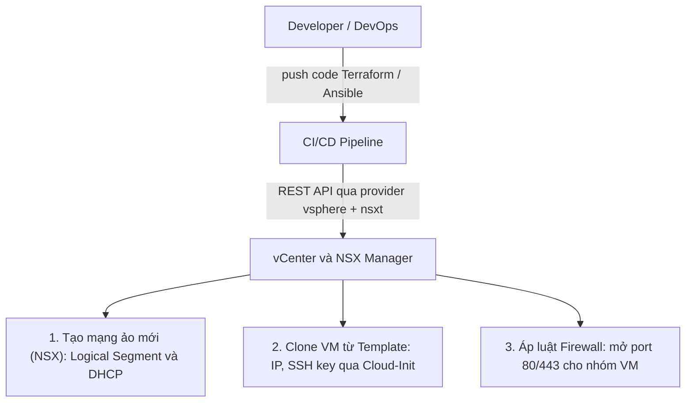
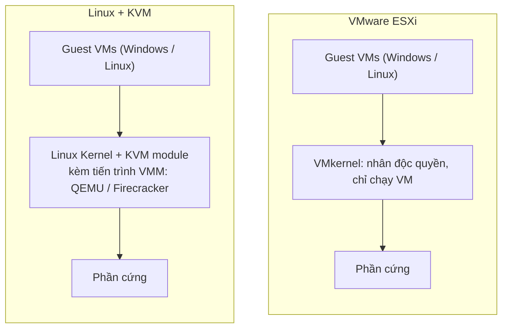
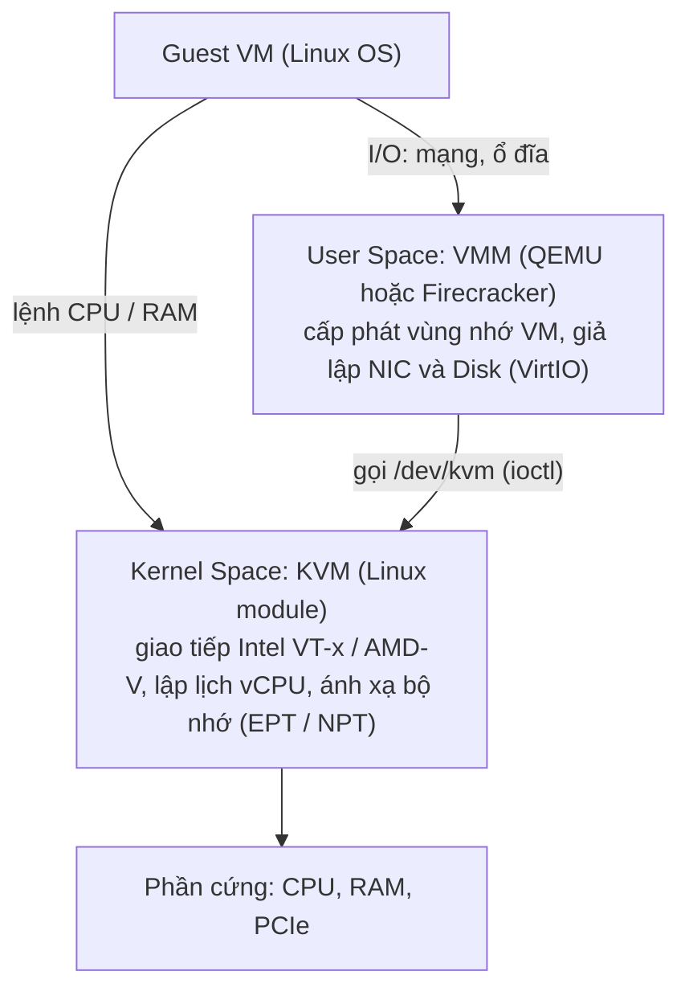
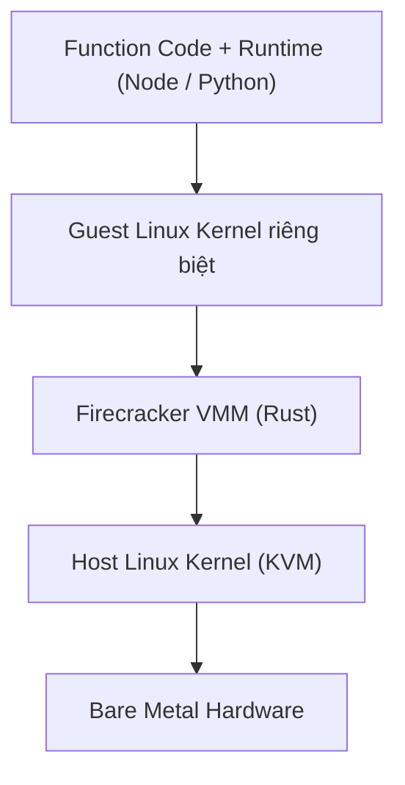
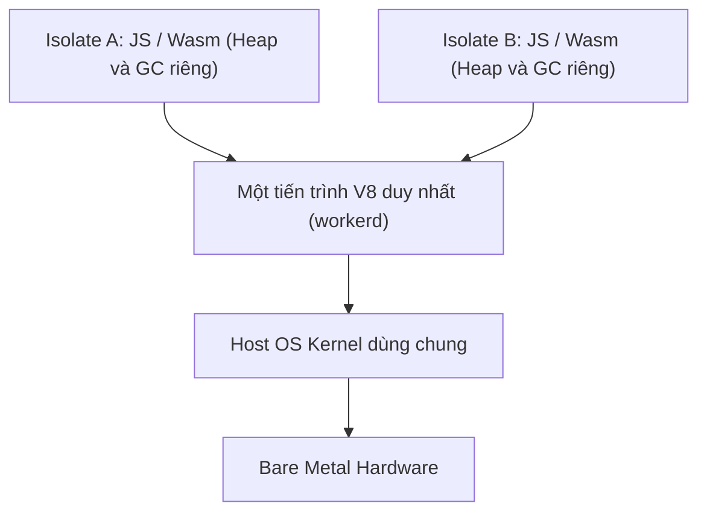

# Ngăn xếp ảo hóa: từ VMware đến KVM, Firecracker và V8 Isolates

Tài liệu đi theo một mạch: vì sao VMware gắn với on-premises, cách dùng VMware dựng Private Cloud bằng IaC, rồi các công nghệ ảo hóa thay thế và cách ly workload: Linux + KVM, Firecracker MicroVM và V8 Isolates.

## 1. Vì sao VMware gắn chặt với on-premises

VMware định hình tiêu chuẩn của trung tâm dữ liệu vật lý hơn hai thập kỷ trước khi cloud bùng nổ. Trước khi Broadcom mua lại, Gartner (qua CIO Dive) cho biết VMware chiếm 97% doanh thu phần mềm ảo hóa. Nguồn gốc nói "hơn 80% workload doanh nghiệp chạy trên VMware" không có nguồn chính thức (con số 80% xuất hiện trong một bài InformationWeek năm 2010 là ước tính của một bên bán hàng, trong khi cùng bài IDC đặt khoảng 50%), nên đừng dùng nó như số liệu thật.

| Nguyên nhân | Giải thích |
|---|---|
| Giải cứu phòng máy trước kỷ nguyên Cloud | Cuối thập niên 1990, quy tắc "1 máy chủ vật lý = 1 ứng dụng" khiến phần lớn CPU và RAM bị bỏ phí. VMware thương mại hóa ảo hóa trên x86 (ESXi), gom hàng chục máy thành một, cắt trực tiếp chi phí phần cứng, điện và làm mát. |
| Tối ưu cho phần cứng chuyên dụng | ESXi là Type-1 hypervisor (cài trực tiếp lên phần cứng thô), khai thác tối đa máy chủ doanh nghiệp (Dell PowerEdge, HPE ProLiant, Cisco UCS) và nói chuyện trực tiếp với lưu trữ tốc độ cao (SAN, Fibre Channel, iSCSI). |
| "Gánh" khả năng chịu lỗi cho ứng dụng cũ | Ứng dụng truyền thống giả định phần cứng không hỏng. vMotion cho phép chuyển VM đang chạy sang máy vật lý khác mà không gián đoạn xử lý. vSphere HA khởi động lại VM trên máy dự phòng khi máy chủ hỏng (HA khởi động lại VM, không live-migrate). |
| Phụ thuộc của cả hệ sinh thái vận hành | Sau 15-20 năm, vCenter là hệ thần kinh trung ương: sao lưu (Veeam, Commvault), giám sát, tường lửa, quy trình xử lý sự cố đều gắn vào API VMware. |
| Pháp lý và chủ quyền dữ liệu | Ngân hàng, tài chính, viễn thông, cơ quan nhà nước bị luật định cấm đưa dữ liệu nhạy cảm ra ngoài. SDDC cho phép tự dựng "đám mây riêng" ngay trong trụ sở mà vẫn kiểm soát vật lý máy chủ và ổ cứng. |

Hai triết lý đối lập: thế giới VMware on-premises được xây để ngăn sự cố phần cứng ở tầng hạ tầng, nhằm bảo vệ ứng dụng cũ không biết tự phục hồi. Public Cloud mặc định máy chủ có thể hỏng bất cứ lúc nào và đòi ứng dụng tự thiết kế khả năng chịu lỗi. Đây là nhận định kiến trúc, không phải sự kiện có nguồn.

## 2. Dùng VMware biến dàn máy thành Private Cloud với IaC

Gom nhiều máy chủ vật lý thành một bể tài nguyên và mở lớp API để công cụ Infrastructure as Code (Terraform, Ansible) cấp phát hạ tầng như gọi API của hyperscaler là định nghĩa của Private Cloud. VMware Cloud Foundation (VCF) thay từng dịch vụ lõi của một hyperscaler:

| Lớp | Hyperscaler (ví dụ AWS) | VMware Private Cloud (SDDC) |
|---|---|---|
| Compute | Amazon EC2 | vSphere (ESXi + vCenter) |
| Network và Security | VPC, Security Group, ALB | VMware NSX (Logical Switch, Distributed Firewall, Load Balancer) |
| Storage | Amazon EBS, EFS | VMware vSAN |
| Kubernetes | Amazon EKS | Gói Kubernetes tích hợp vSphere. Tên cũ là Tanzu, nay Broadcom gộp thành vSphere Kubernetes Service (VKS). |
| Cổng tự phục vụ | AWS Console, Service Catalog | VMware Aria Automation (trước là vRealize Automation, và từ VCF 9 được đổi tên thành VCF Automation) |
| IaC | Terraform (aws provider) | Terraform (provider `vsphere` và `nsxt`), Ansible, Packer |

Hai provider `vmware/vsphere` và `vmware/nsxt` đều tồn tại trên Terraform Registry, Packer có plugin vSphere với builder `vsphere-iso` và `vsphere-clone`.

- Dùng Packer đóng gói bản mẫu hệ điều hành chuẩn (Golden Image).
- `terraform apply` nói chuyện trực tiếp với API vCenter và NSX Manager: tạo phân đoạn mạng cô lập, nhân bản VM từ template, cấu hình IP/hostname bằng Cloud-Init, gắn luật tường lửa phân tán và trỏ Load Balancer vào cụm trong vài phút.
- Muốn cho các team tự bấm tạo tài nguyên trong hạn mức kèm Showback/Chargeback thì cài thêm Aria Automation ở lớp trên cùng.

### Bốn giới hạn so với hyperscaler

| Giới hạn | Nội dung |
|---|---|
| Co giãn hữu hạn | Khi CPU/RAM của dàn máy chạm 100%, `terraform apply` báo thiếu tài nguyên cho tới khi có người mua và cắm thêm server. |
| Thiếu Managed PaaS và Serverless | Tự động hóa dừng ở IaaS (VM) và CaaS (Kubernetes). Cần PostgreSQL hay Kafka thì vẫn tự dựng VM hoặc container và tự quản trị. |
| Gánh nặng Day-2 | Phải tự xử lý phần cứng hỏng, firmware/BIOS, và đồng bộ phiên bản giữa ESXi, vCenter, NSX, vSAN. |
| Chi phí bản quyền | Bản quyền per-core của VCF đắt (xem `licensing-and-cloud-lock-in.md`). Với quy mô vừa, homelab hay startup, nhiều kỹ sư chọn Proxmox + Terraform hoặc OpenStack. |

## 3. Linux + KVM thay thế ESXi

Hoàn toàn đúng: Linux + KVM chạy máy ảo tương đương ESXi. Module KVM nằm trong nhân Linux (tích hợp từ 2.6.20, phát hành 05/02/2007) và điều khiển trực tiếp tập lệnh ảo hóa Intel VT-x hoặc AMD-V, nên chính nhân Linux trở thành Type-1 hypervisor, không phải Type-2 như VirtualBox trên Windows.

| Tiêu chí | VMware ESXi | Linux + KVM |
|---|---|---|
| Triết lý | OS chuyên biệt tối giản, cắt mọi thứ không phục vụ ảo hóa. Tài liệu ESX 9.0 yêu cầu ổ khởi động tối thiểu 32 GB (khuyến nghị 128 GB), không đưa con số kích thước image. Con số "300-400 MB" trong nguồn gốc không được xác minh. Broadcom 9.0 gọi sản phẩm là "ESX". | Nhân đa năng: vừa chạy VM vừa chạy Docker và công cụ Linux ngay trên máy mẹ. |
| Phần cứng | Chỉ hỗ trợ máy trong Broadcom Compatibility Guide (HCL). | Rất rộng, hưởng kho driver của Linux. |
| Lưu trữ, mạng | Hệ sinh thái VMware (vSAN, NSX). | ZFS, Ceph, Open vSwitch, eBPF, nftables. |
| Bản quyền | Thuê bao per-core dưới thời Broadcom. | Mã nguồn mở GPL, chỉ trả tiền nếu mua hỗ trợ (Red Hat, Canonical). |

Linux + KVM + QEMU chỉ tương đương phần lõi ESXi (thao tác qua `virsh` hoặc giao diện đơn giản). Để có trải nghiệm quản trị cụm giống ESXi + vCenter (live migration, HA, kho lưu trữ chung), các hãng đóng gói Linux + KVM thành bản phân phối:

- **Proxmox VE:** xây trên Debian Linux + KVM, có giao diện web quản trị cụm, sao lưu và tích hợp Ceph (Ceph là tùy chọn, ZFS cũng được hỗ trợ).
- **Nutanix AHV:** hạ tầng siêu hội tụ (HCI) dựa trên Linux, QEMU và KVM.
- **KubeVirt (OpenShift Virtualization, SUSE Harvester):** chạy VM KVM bên trong cụm Kubernetes. OpenShift Virtualization ghi rõ "based on KVM and the upstream KubeVirt project". Harvester (nay là SUSE Virtualization) xây trên Kubernetes, KubeVirt và Longhorn, các nguồn khác nhau về việc có nêu tên KVM hay không (KubeVirt tự nó chạy trên KVM).
- **AWS Nitro và Google Compute Engine:** AWS gọi Nitro Hypervisor là "based on Linux/Kernel-based Virtual Machine (KVM)", Google gọi hypervisor của Compute Engine là "KVM-based". Cả hai đều không nêu dùng ESXi, nên "không dùng ESXi" là suy ra chứ không phải câu khẳng định.

## 4. KVM và VMM: hai nửa của một hệ thống ảo hóa

KVM nằm trong nhân hệ điều hành (Kernel Space) và điều khiển trực tiếp CPU và RAM. VMM (Virtual Machine Monitor) chạy ở User Space, giả lập thiết bị ngoại vi (card mạng, ổ đĩa) và quản lý vòng đời VM. QEMU và Firecracker đều là VMM.

- **KVM xử lý lõi tính toán:** lập lịch vCPU và ánh xạ địa chỉ bộ nhớ ảo sang RAM vật lý (EPT của Intel, NPT của AMD). KVM chỉ cần Intel VT-x hoặc AMD-V trên x86. Tài liệu nhân xác nhận giao diện `/dev/kvm` và các ioctl, ABI được ổn định từ 2.6.22.
- **VMM xử lý thiết bị:** khi VM đọc ghi đĩa hoặc gửi gói tin, CPU kích hoạt một VM-Exit, chuyển quyền điều khiển về KVM. KVM nhận ra đây là tác vụ thiết bị và đẩy lên VMM, VMM đọc ghi vào file ảnh đĩa (`.qcow2`, `.ext4`) hoặc đẩy gói tin ra card mạng ảo (TAP device).
- **Lưu ý:** KVM cũng giả lập một vài thiết bị ngay trong nhân (PIC, IOAPIC, PIT) và có trên cả ARM, nơi không dùng VT-x hay AMD-V.

Tách đôi giúp giữ phần lõi CPU/RAM ổn định trong nhân Linux và tự do đổi lớp vỏ VMM:

| VMM | Đặc điểm |
|---|---|
| QEMU | VMM đa năng, giả lập hàng trăm loại phần cứng. Mã nguồn C hơn 1,4 triệu dòng (số từ khoảng 2018-2020, mang tính xấp xỉ), khởi động chậm hơn và có tiền lệ lỗi thoát khỏi VM qua lỗi giả lập thiết bị. |
| Firecracker | VMM viết lại từ đầu bằng Rust (khoảng 50.000 dòng), chỉ giữ thiết bị VirtIO tối giản, thu hẹp bề mặt tấn công. |

## 5. Firecracker MicroVM: an toàn như VM, nhẹ như container

Trước đây hạ tầng cloud kẹt giữa hai lựa chọn: VM truyền thống an toàn vì có OS riêng nhưng khởi động chậm, container nhanh nhưng dùng chung nhân với máy mẹ nên rủi ro khi chạy mã không đáng tin trong môi trường multi-tenant.

- **Nguồn gốc:** trình giám sát máy ảo mã nguồn mở của AWS, viết bằng Rust, chạy trên Linux KVM. Trang Firecracker ghi: chạy ở user space và dùng KVM để tạo microVM.
- **Thiết bị tối giản:** VirtIO Net, VirtIO Block, Vsock, serial console và một bộ điều khiển bàn phím một phần (chỉ để phát tín hiệu reboot từ guest). Nguồn gốc nói "đúng 4 thiết bị" là cách diễn đạt gần đúng, tài liệu thiết kế còn liệt kê cả Vsock.
- **Hiệu năng (theo SPECIFICATION chính thức):** thread của VMM có memory overhead tối đa 5 MiB (chỉ tính phần VMM, không gồm RAM của guest), và mất tối đa 125 ms từ lúc nhận API call `InstanceStart` đến khi tiến trình `/sbin/init` của guest bắt đầu chạy (không phải boot tới ứng dụng).
- **Ai dùng:** AWS Lambda và AWS Fargate chạy trên Firecracker microVM (thông báo chính thức của AWS 2018). Fly.io chạy ứng dụng trong Firecracker microVM theo tài liệu kiến trúc của họ.
- **Vercel cần cẩn thận:** Vercel chỉ khẳng định Firecracker cho Vercel Sandbox ("Each sandbox runs in a secure Firecracker microVM"). Tài liệu Fluid compute cho Vercel Functions không nêu công nghệ, mà nói thay vì một microVM cho mỗi lần gọi thì nhiều lần gọi có thể dùng chung một instance vật lý. Nguồn gốc xếp Vercel Functions vào Firecracker là chưa đúng.
- **Giá trị cốt lõi:** mỗi hàm chạy trong một microVM có nhân Linux riêng, nên dù mã của một khách bị chiếm quyền bên trong, họ vẫn bị chặn bởi lớp ảo hóa phần cứng.

## 6. V8 Isolates: cơ chế bảo mật của trình duyệt đưa lên đám mây

V8 là engine JavaScript và WebAssembly mã nguồn mở của Google (lõi của Chrome và Node.js). Trình duyệt dùng Isolate để nhốt mỗi trang vào sandbox riêng. Cloudflare Workers (và Deno Deploy, Fastly) đưa kiến trúc này lên máy chủ biên (Edge).

- **Cách vận hành:** một tiến trình V8 duy nhất chứa hàng nghìn Isolate, mỗi Isolate có Heap và Garbage Collector riêng. Không phải khởi động OS hay tạo tiến trình mới. Cloudflare từ 2018 nói "a single process can run hundreds or thousands of Isolates". README của `workerd` lưu ý rõ nó "is not a hardened sandbox", nên production không chỉ dựa vào V8.
- **Khởi động:** câu "Isolates start in 5 milliseconds" là cách viết của blog Cloudflare 2018. Tài liệu và marketing hiện tại nói "zero cold starts" (không có cold start), nên đừng coi "dưới 5 ms" là cam kết hiện hành.
- **Giới hạn hiện hành:** 128 MB bộ nhớ mỗi isolate (gồm cả JavaScript heap và WebAssembly allocations). Giới hạn dung lượng nén 3 MB (Free) và 10 MB (Paid) đã bị bỏ ngày 04/09/2026, thay bằng giới hạn 64 MiB cho bundle chưa nén trên mọi gói. Bất kỳ trang nào còn ghi 3/10 MB là đã cũ.
- **Tính tiền:** theo số request cộng thời gian CPU, không tính thời gian chờ I/O. Gói Paid gồm 10 triệu request và 30 triệu ms CPU, vượt thì $0.30 mỗi triệu request và $0.02 mỗi triệu ms CPU. Không tính phí theo thời lượng.
- **Phạm vi:** trang sản phẩm Workers ghi "330+ cities", rộng hơn con số "300+" ở nguồn gốc.
- **Đánh đổi:** chỉ chạy được ngôn ngữ biên dịch ra JavaScript hoặc WebAssembly, không có môi trường Linux đầy đủ (không gọi lệnh hệ thống tùy ý, không chạy thư viện C++ gắn chặt vào OS như trên Firecracker).

### So sánh nhanh

| Đặc điểm | Firecracker MicroVM | V8 Isolates |
|---|---|---|
| Ranh giới cách ly | Ảo hóa phần cứng: mỗi hàm một nhân Linux riêng | Runtime: dùng chung tiến trình V8 và nhân OS, tách Heap |
| Khởi động | Tối đa 125 ms tới `/sbin/init` | Cloudflare quảng bá "zero cold starts" |
| RAM nền | Tối đa 5 MiB cho VMM, cộng RAM của nhân Linux rút gọn | Vài MB mỗi Isolate (số liệu "2-3 MB" của nguồn gốc không được xác minh) |
| Ngôn ngữ | Mọi ngôn ngữ và nhị phân Linux, Docker image | JS/TS và WebAssembly |
| Nền tảng tiêu biểu | AWS Lambda, AWS Fargate, Fly.io, Vercel Sandbox | Cloudflare Workers, Deno Deploy |

Hai công nghệ bổ trợ nhau: V8 Isolates ở lớp biên sát người dùng cho tác vụ cần phản hồi trong vài mili-giây (định tuyến, xác thực token, biến đổi nhẹ). Firecracker MicroVM cho backend phức tạp cần môi trường Linux đầy đủ, kết nối database sâu hoặc thư viện đa ngôn ngữ nặng. Đây là nhận định kiến trúc.

So sánh với serverless trên Vercel và Cloudflare xem `serverless-and-cloud-wrappers.md`. Về WebAssembly chạy trên V8 xem `webassembly-use-cases-and-shared-core.md`.

## Kiểm chứng

Đối chiếu với nguồn chính thức, ngày 2026-11-18.

| Điểm | Kết quả | Nguồn |
|---|---|---|
| Firecracker dùng KVM, chạy ở user space | Đúng. | [Firecracker spec](https://raw.githubusercontent.com/firecracker-microvm/firecracker/main/SPECIFICATION.md#:~:text=It%20takes%20%60%3C%3D%20125%20ms%60) (fragment unverified) |
| Thiết bị: VirtIO Net, VirtIO Block, serial console, bàn phím một phần | Đúng. | [Firecracker design](https://raw.githubusercontent.com/firecracker-microvm/firecracker/main/docs/design.md#:~:text=It%20also%20exposes%20a%20serial%20console%20and%20partial%20keyboard%20controller) |
| Lambda và Fargate dùng Firecracker | Đúng. | [AWS What's New](https://aws.amazon.com/about-aws/whats-new/2018/11/firecracker-lightweight-virtualization-for-serverless-computing/#:~:text=AWS%20Lambda%20uses%20Firecracker) |
| Vercel Sandbox dùng Firecracker | Đúng, riêng cho Sandbox. | [Vercel docs](https://vercel.com/docs/vercel-sandbox#:~:text=Each%20sandbox%20runs%20in%20a%20secure%20Firecracker%20microVM) |
| Fluid compute không dùng một microVM mỗi lần gọi | Đúng. | [Vercel docs](https://vercel.com/docs/fluid-compute#:~:text=Instead%20of%20using%20a%20microVM%20for%20each%20function%20invocation) |
| Fly.io chạy ứng dụng trong Firecracker | Đúng. | [Fly.io docs](https://docs.fly.io/reference/architecture#:~:text=Application%20code%20runs%20in%20Firecracker%20microVMs) |
| QEMU hơn 1,4 triệu dòng, Firecracker 50.000 dòng | Đúng, số xấp xỉ. | [Amazon Science](https://www.amazon.science/blog/how-awss-firecracker-virtual-machines-work#:~:text=more%20than%201.4%20million%20lines%20of%20code) |
| KVM trong Linux 2.6.20, cần VT-x hoặc AMD-V | Đúng. | [KVM project](https://linux-kvm.org/page/Main_Page#:~:text=included%20in%20mainline%20Linux%2C%20as%20of%202.6.20) |
| Nitro Hypervisor dựa trên KVM | Đúng. | [AWS Security Blog](https://aws.amazon.com/blogs/security/ec2-defenses-against-l1tf-reloaded/#:~:text=based%20on%20Linux%2FKernel%2Dbased%20Virtual%20Machine) (fragment unverified) |
| Hypervisor của Compute Engine dựa trên KVM | Đúng. | [Google Cloud docs](https://docs.cloud.google.com/compute/docs/instances/nested-virtualization/overview#:~:text=security%2Dhardened%2C%20KVM%2Dbased%20hypervisor) |
| Proxmox VE dựa trên Debian và KVM | Đúng. | [Proxmox](https://www.proxmox.com/en/products/proxmox-virtual-environment/features#:~:text=Proxmox%20Virtual%20Environment%20is%20based%20on%20Debian%20GNU%2FLinux) |
| Nutanix AHV dựa trên Linux, QEMU, KVM | Đúng. | [Nutanix Bible](https://www.nutanixbible.com/5a-book-of-ahv-architecture.html#:~:text=AHV%20is%20based%20upon%20Linux) |
| OpenShift Virtualization dựa trên KVM và KubeVirt | Đúng. | [Red Hat](https://www.redhat.com/en/resources/openshift-virtualization-faq#:~:text=OpenShift%20Virtualization%20is%20based%20on%20KVM) |
| ESX có yêu cầu HCL, ổ khởi động tối thiểu 32 GB | Đúng. | [Broadcom TechDocs](https://techdocs.broadcom.com/us/en/vmware-cis/vsphere/vsphere/9-0/esx-installation-and-setup/installing-and-setting-up-esxi/esxi-requirements/esxi-hardware-requirements.html#:~:text=ESX%209.0%20requires%20a%20boot%20disk%20of%20at%20least%2032%20GB) |
| vSphere HA khởi động lại VM trên host khác | Đúng. | [Broadcom TechDocs](https://techdocs.broadcom.com/us/en/vmware-cis/vsphere/vsphere/7-0/vsphere-availability/creating-and-using-vsphere-ha-clusters/how-vsphere-ha-works.html#:~:text=the%20virtual%20machines%20on%20a%20failed%20host%20are%20restarted%20on%20alternate%20hosts) |
| Provider Terraform `vsphere` và `nsxt`, plugin Packer vSphere | Đúng. | [Terraform Registry](https://registry.terraform.io/v1/providers/vmware/vsphere), [Packer plugin](https://github.com/hashicorp/packer-plugin-vsphere) |
| Aria Automation là vRealize Automation đổi tên | Đúng. | [Broadcom KB](https://knowledge.broadcom.com/external/article/318130/build-numbers-and-versions-for-vmware-ar.html) (fragment unverified) |
| Giới hạn bộ nhớ Workers 128 MB mỗi isolate | Đúng. | [Cloudflare docs](https://developers.cloudflare.com/workers/platform/limits/#:~:text=Each%20isolate%20can%20consume%20up%20to%20128%20MB) |
| Giới hạn 3/10 MB nén đã bị bỏ | Đúng, 04/09/2026. | [Cloudflare changelog](https://developers.cloudflare.com/changelog/post/2026-09-04-increased-worker-size-limit/#:~:text=The%20compressed%20Worker%20size%20limits) |
| "Isolates start in 5 milliseconds" | Cách viết của blog 2018. | [Cloudflare blog](https://blog.cloudflare.com/cloud-computing-without-containers/#:~:text=Isolates%20start%20in%205%20milliseconds) |
| VMware chiếm 97% doanh thu phần mềm ảo hóa trước khi sáp nhập | Theo Gartner qua CIO Dive. | [CIO Dive](https://www.ciodive.com/news/broadcom-vmware-acquistion-vcf-private-cloud/733800/#:~:text=commanded%2097%25%20of%20the%20virtualization%20software%20market%20revenue) |
| Giá VCF khoảng $350, mức sàn 16 nhân | Xem `licensing-and-cloud-lock-in.md`. | |

Chưa xác minh được:

- Phần "hơn 80% workload doanh nghiệp chạy VMware lúc đỉnh cao" (không tìm thấy nguồn chính, xem mục 1).
- Kích thước cài đặt của ESXi "300-400 MB" (tài liệu chính thức chỉ nêu yêu cầu ổ khởi động).
- Các CVE về thoát VM của QEMU (CVE-2020-14364, CVE-2015-5165, CVE-2015-7504) chỉ tìm thấy qua tìm kiếm, chưa mở trang NVD. EPT/NPT chưa kiểm chứng từ trang chính thức.
- Số RAM "2-3 MB mỗi Isolate" và so sánh "100-150 ms" của Firecracker trong khung thực tế.
- Bốn thiết bị của Firecracker: tài liệu thiết kế liệt kê thêm Vsock.
