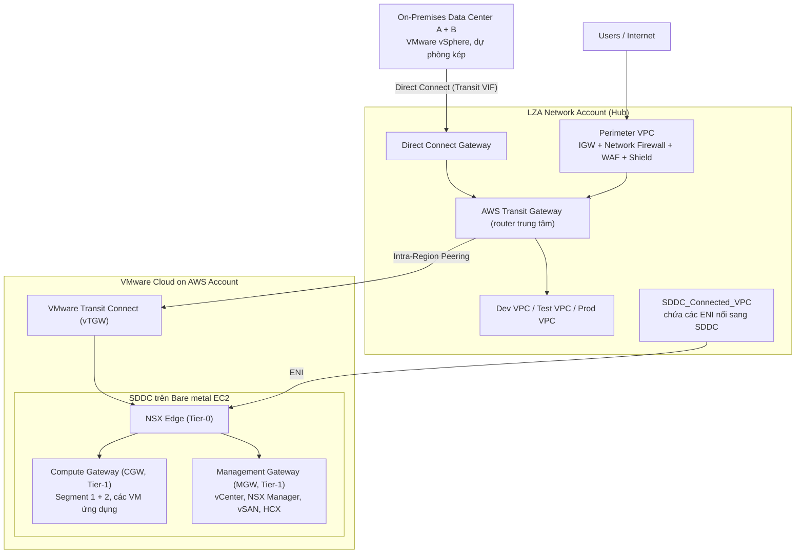
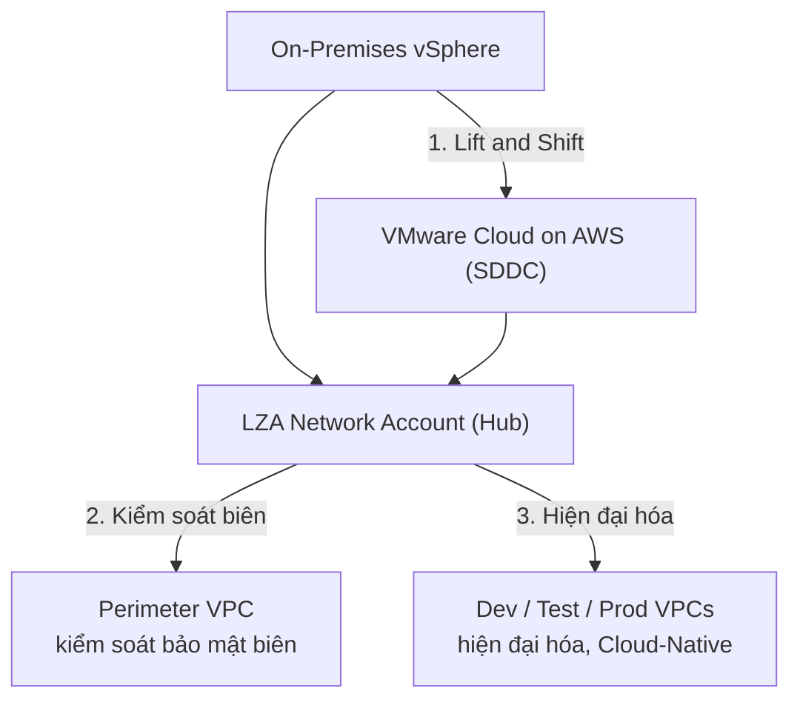
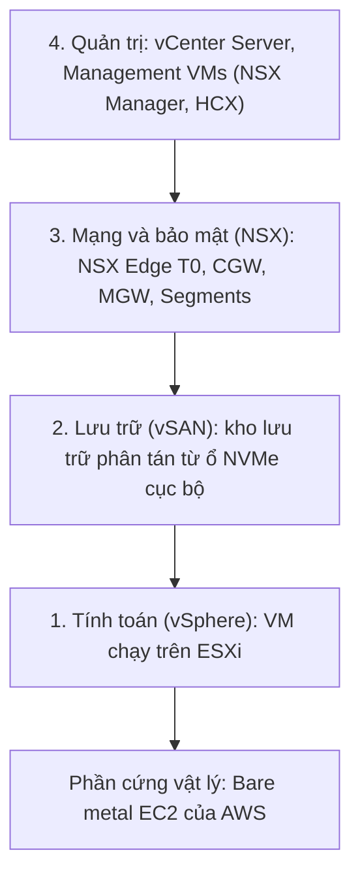
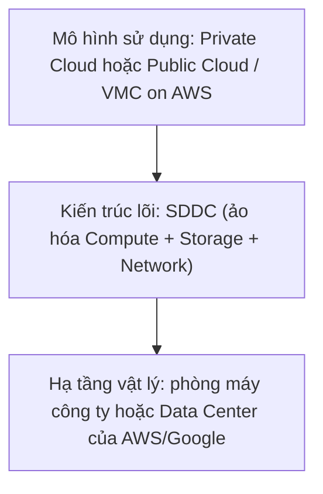
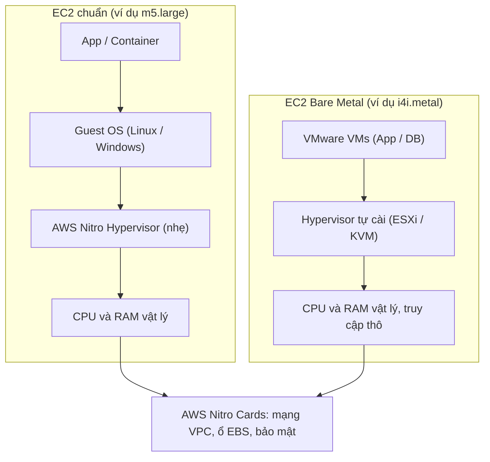
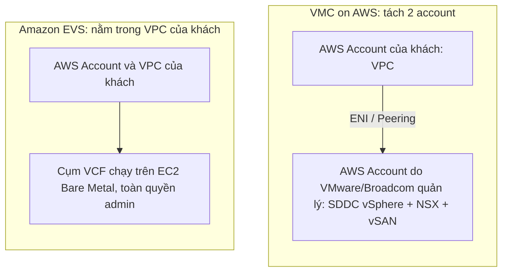

# Kiến trúc hybrid VMware trên AWS

Tài liệu này giải thích một kiến trúc mạng lai gồm trung tâm dữ liệu tại chỗ (On-Premises), AWS Landing Zone và VMware Cloud on AWS (VMC on AWS). Phần sau đi sâu vào khái niệm SDDC, EC2 Bare Metal cùng AWS Nitro, và so sánh VMC on AWS với Amazon EVS sau khi Broadcom mua VMware.

## 1. Bức tranh tổng thể

Sơ đồ gốc kết nối hai trung tâm dữ liệu vật lý có VMware vSphere với hệ sinh thái AWS (quản lý theo Landing Zone Accelerator, viết tắt LZA) và với VMware Cloud on AWS.

### Các vùng kiến trúc

| Vùng | Thành phần | Vai trò |
|---|---|---|
| On-Premises và Internet | Data Center A và B; Direct Connect Location A và B; người dùng Internet | Hai phòng máy vật lý chạy vSphere, nối lên AWS bằng đường cáp riêng. Direct Connect dùng Transit VIF để định tuyến qua Transit Gateway. |
| LZA Network Account | Direct Connect Gateway, Transit Gateway, Perimeter VPC, các VPC Dev/Test/Prod, SDDC_Connected_VPC | Tài khoản Network Hub: định tuyến và kiểm soát bảo mật tập trung. Direct Connect Gateway gom các kết nối Direct Connect rồi gắn vào Transit Gateway. Perimeter VPC (còn gọi Inspection VPC) giữ lưu lượng Bắc-Nam: có Internet Gateway, AWS Network Firewall, kết hợp AWS WAF (tường lửa ứng dụng web) và AWS Shield (chống DDoS). SDDC_Connected_VPC chứa các Elastic Network Interface (ENI) gắn thẳng vào hạ tầng VMware. |
| VMware Cloud on AWS Account | VMware Transit Connect, SDDC, NSX Edge (T0), CGW, MGW | Các cụm ESXi chạy trên bare metal EC2. Transit Connect là một AWS Transit Gateway do VMware quản lý, peering với Transit Gateway của khách trong cùng Region. Trong SDDC, NSX Edge (Tier-0) chia hai nhánh Tier-1: CGW cho lưu lượng VM ứng dụng, MGW cô lập lưu lượng quản trị. |

## 2. Ba luồng lưu lượng

| Luồng | Đường đi | Mục đích |
|---|---|---|
| Connected VPC traffic | VM trong SDDC - NSX Edge (T0) - ENI trong SDDC_Connected_VPC | VM VMware nói chuyện trực tiếp với tài nguyên trong VPC đó và với dịch vụ AWS native (S3, RDS, FSx) với băng thông cao, độ trễ thấp. |
| On-Premises traffic | Data Center A/B - Direct Connect (Transit VIF) - Direct Connect Gateway - Transit Gateway - VPC Dev/Test/Prod, hoặc qua Intra-Region Peering sang VMware Transit Connect - NSX Edge - VM trong SDDC | Kết nối nội bộ xuyên suốt giữa tại chỗ, VPC và SDDC: đồng bộ dữ liệu, di chuyển VM (vMotion, HCX), vận hành. |
| External traffic | Users - Internet (qua WAF/Shield) - Internet Gateway ở Perimeter VPC - AWS Network Firewall - Transit Gateway - VPC hoặc SDDC | Mọi ingress và egress Internet đi qua một điểm kiểm soát duy nhất ở Perimeter VPC. |

### Điểm mạnh của thiết kế

- **Kiểm soát bảo mật tập trung:** không mở Internet trực tiếp ở từng VPC hay SDDC, gom về Perimeter VPC để lọc bằng Network Firewall và áp chính sách đồng nhất.
- **Hub-and-Spoke dễ mở rộng:** Transit Gateway cùng VMware Transit Connect cho phép gắn thêm VPC hoặc SDDC mà không làm rối cấu trúc mạng.
- **Đường tắt tới dịch vụ AWS native:** cơ chế Connected VPC ENI kết nối VMware với AWS trực tiếp, không đẩy toàn bộ lưu lượng nội bộ qua lớp trung gian.

## 3. Vì sao "On-Premises" khi VMware cũng chạy trên AWS?

Sơ đồ có hai môi trường VMware riêng biệt. Bên trái là On-Premises, nằm ngoài khung AWS Cloud, là phòng máy vật lý do doanh nghiệp sở hữu và chạy vSphere truyền thống. Bên phải là VMware Cloud on AWS, nằm trong hạ tầng AWS, chạy trên máy chủ vật lý chuyên dụng của AWS. Nhãn "On-Premises Traffic" đặt tên cho luồng xuất phát hoặc kết thúc ở On-Premises, không phải tên của cụm VMware bên phải.

Doanh nghiệp chạy VMware ở cả hai nơi vì chuyển hàng trăm VM VMware sang EC2 thuần phải đổi định dạng đĩa và cấu hình lại mạng. Dùng VMC on AWS thì giữ nguyên công cụ (vCenter, NSX) và dùng VMware HCX hoặc vMotion để đẩy VM từ tại chỗ lên mà không sửa ứng dụng hay đổi IP.

## 4. Mục đích kinh doanh của kiến trúc

| Động lực | Giải thích |
|---|---|
| Chuyển CAPEX sang OPEX, thoát Data Center | Hợp đồng thuê phòng máy sắp hết hoặc phần cứng hết vòng đời bảo hành thì phải bỏ hàng triệu USD mua mới. Thuê bao VMC on AWS cho phép rút dần khỏi phòng máy vật lý mà không gián đoạn. |
| Lift-and-Shift nhanh, không viết lại code | ERP, Core Banking, phần mềm đặc thù có thể mất mã nguồn hoặc quá phức tạp. Re-architect có thể mất 2-3 năm. Giữ nguyên định dạng VM và dải IP nội bộ thì đưa lên trong vài tuần. |
| Disaster Recovery (DR) tối ưu chi phí | Compliance buộc có site dự phòng xa site chính. Thay vì xây Data Center thứ hai nằm chờ, dùng VMC on AWS với cấu hình tối thiểu để đồng bộ, khi có sự cố mới scale-out. |
| Cloud Bursting và M&A | Mùa cao điểm cần thêm máy trong vài chục phút thay vì 3-6 tháng đặt server vật lý. Khi mua lại công ty cũng dùng VMware, gộp hạ tầng lên VMC ngay mà chưa đụng mạng tại chỗ. |
| Tận dụng nhân sự hiện có | Đội IT Ops đã thành thạo vSphere, vCenter, NSX. Chuyển hẳn sang AWS native ngay sẽ tốn đào tạo và tăng rủi ro vận hành. |
| Bàn đạp hiện đại hóa từng phần | Qua SDDC_Connected_VPC, VM VMware gọi được RDS, S3, dịch vụ AI/Analytics. Giữ Database/Backend cũ trên VMware, xây tính năng mới (frontend, mobile API, analytics) bằng AWS native xung quanh. |

Về dài hạn, kiến trúc này thường phục vụ một trong hai kịch bản: giai đoạn quá độ (dần chuyển sang AWS native rồi tắt on-premises) hoặc trạng thái cân bằng cố định (dữ liệu nhạy cảm bắt buộc ở trong nước nằm tại chỗ, tải cần linh hoạt đẩy lên AWS).

## 5. Landing Zone (LZA) và Lift-and-Shift

Cụm VMware Cloud on AWS mới là đích trực tiếp của chiến lược Lift-and-Shift (Rehost). LZA là bộ khung hạ tầng doanh nghiệp (Enterprise Foundation) đỡ không chỉ Lift-and-Shift mà cả vận hành và hiện đại hóa về sau. Nếu chỉ bưng VM lên cho xong, nối Direct Connect thẳng vào VMware Cloud là đủ. Việc dựng thêm LZA Network Account với Transit Gateway, Perimeter VPC và các VPC Dev/Test/Prod phục vụ ba mục tiêu:

1. **Bãi đáp an toàn trước khi di chuyển:** có sẵn kiểm soát lưu lượng (Network Firewall, WAF, Shield) để đáp ứng compliance như PCI-DSS, ISO hoặc quy định tài chính.
2. **Chuẩn bị cho hiện đại hóa:** Lift-and-Shift thường chỉ là bước đệm. Các VPC Dev/Test/Prod cùng SDDC_Connected_VPC cho thấy đã chuẩn bị chỗ để Replatform hoặc Refactor, dần tách module sang EKS, RDS, S3, Serverless.
3. **Hybrid và DR dài hạn:** nhiều doanh nghiệp giữ cấu trúc này vĩnh viễn: hệ thống đặc thù ở On-Premises, VMC làm site DR hoặc mở rộng mùa cao điểm, ứng dụng số mới xây trên Prod VPC.

## 6. SDDC - Software-Defined Data Center

SDDC (Trung tâm dữ liệu định nghĩa bằng phần mềm) là mô hình ảo hóa cả một phòng máy: máy chủ tính toán, lưu trữ, thiết bị mạng và bảo mật, rồi điều khiển qua lớp phần mềm. Ảo hóa truyền thống chỉ chia một máy vật lý thành nhiều VM. SDDC ảo hóa cả phòng máy, nên tạo phân vùng mạng, cấu hình tường lửa hay mở rộng lưu trữ đều làm bằng API hoặc Infrastructure as Code thay vì cắm cáp hay lắp thiết bị.

Khối SDDC trong VMware Cloud on AWS có bốn lớp xếp chồng trên phần cứng vật lý:

| Lớp | Công nghệ | Vai trò |
|---|---|---|
| Compute | VMware vSphere (hypervisor ESXi) | Cài trực tiếp lên máy bare metal, gom CPU và RAM thành bể tài nguyên chung cấp cho VM. |
| Networking và Security | VMware NSX | Thay router và tường lửa vật lý bằng phần mềm: NSX Edge T0, Distributed Router, Logical Network Segment, tách CGW (mạng ứng dụng) khỏi MGW (mạng quản trị). |
| Storage | VMware vSAN | Gom ổ SSD/NVMe cục bộ của từng máy thành kho lưu trữ dùng chung tốc độ cao, bỏ nhu cầu mua tủ đĩa SAN/NAS vật lý. |
| Management | vCenter và Management VMs | Điều khiển toàn cụm từ một giao diện, đồng nhất với cách quản trị VMware tại chỗ. |

### SDDC khác Cloud ở đâu?

Public Cloud (AWS, Azure, GCP) vận hành dựa trên kiến trúc SDDC ở tầng dưới. Hai thuật ngữ mô tả hai tầng ý nghĩa khác nhau: SDDC là kiến trúc công nghệ (cách xây hạ tầng), Cloud là mô hình cung cấp và tiêu thụ dịch vụ (cách thuê và tính tiền).

| Tiêu chí | SDDC | Cloud |
|---|---|---|
| Bản chất | Kiến trúc kỹ thuật: ảo hóa và lập trình hóa toàn bộ phần cứng trung tâm dữ liệu. | Mô hình kinh doanh và vận hành: cung cấp tài nguyên theo nhu cầu qua mạng. |
| Vị trí phần cứng | Bất kỳ đâu: phòng máy công ty hoặc hạ tầng thuê ngoài. | Thường ở Data Center quy mô siêu lớn của nhà cung cấp. |
| Quyền kiểm soát lõi | Người vận hành nắm hypervisor (vCenter), mạng ảo (NSX), lưu trữ (vSAN). | Nhà cung cấp giấu hạ tầng vật lý và hypervisor, người dùng chỉ gọi API. |
| Thanh toán | Tự đầu tư phần cứng và mua bản quyền (hoặc thuê trọn cụm bare metal). | Trả theo mức dùng thực tế (pay-as-you-go). |

Ba lý do SDDC tồn tại như một thuật ngữ riêng:

- **Nguồn gốc lịch sử:** VMware phổ biến thuật ngữ này khoảng năm 2012. Ngân hàng và cơ quan nhà nước khi đó chưa thể đưa dữ liệu lên Public Cloud vì rào cản pháp lý, nhưng muốn có hạ tầng tự động hóa như AWS. SDDC là nền tảng cho Private Cloud.
- **Tách phần mềm khỏi vị trí phần cứng:** cùng một kiến trúc SDDC triển khai được ở tầng hầm công ty lẫn trên máy chủ vật lý của AWS, tạo sự đồng nhất cho Hybrid Cloud.
- **Ranh giới trách nhiệm:** "triển khai trên AWS (EC2/RDS)" nghĩa là AWS quản lý lớp ảo hóa bên dưới. "Triển khai cụm SDDC trên AWS" nghĩa là doanh nghiệp tự quản lý lớp ảo hóa mạng, lưu trữ và VM trên phần cứng thô AWS cho thuê.

## 7. EC2 Bare Metal và AWS Nitro

SDDC trên AWS chạy được nhờ Amazon EC2 Bare Metal Instances (các instance hậu tố `.metal` như `i3.metal`, `i4i.metal`, `m5.metal`, `mac2.metal`). EC2 chuẩn cho bạn một VM chạy trên hypervisor của AWS. Với máy `.metal`, không có hypervisor AWS, quyền điều khiển CPU vật lý, RAM và tập lệnh ảo hóa phần cứng (Intel VT-x / AMD-V) giao thẳng cho bạn, nên bạn cài được OS riêng hoặc hypervisor riêng (VMware ESXi, KVM, Proxmox).

Câu hỏi hay gặp: không có hypervisor AWS thì sao máy vẫn cắm được vào VPC, gắn EBS, áp Security Group? Câu trả lời là AWS Nitro System: thay vì chạy phần mềm ảo hóa mạng và đĩa trên CPU chính, AWS dùng các bo mạch chuyên dụng (Nitro Cards) cắm vào khe PCIe.

- **Mạng (Nitro Card for VPC):** hiện ra với OS như một card mạng (NIC) bình thường, bên dưới phần cứng tự đóng gói theo giao thức VPC.
- **Lưu trữ (Nitro Card for EBS):** biến ổ EBS gắn vào thành một ổ NVMe vật lý trên bus PCIe.
- **Bảo mật (Nitro Security Chip):** chặn mọi thao tác ghi vào firmware, nên CPU chính không thể cập nhật firmware khi chạy bare metal. Đây là căn cứ để máy trả về sạch trước khi giao khách tiếp theo (cách diễn đạt "khóa quyền ghi đè BIOS" trong nguồn gốc là diễn giải).

### Các trường hợp dùng bare metal ngoài VMware

| Use case | Lý do |
|---|---|
| macOS trên cloud (`mac1.metal`, `mac2.metal` và các dòng Mac mới hơn) | Chạy trên Mac mini (và Mac Studio ở các dòng mới) vật lý gắn với một Nitro Controller. Chỉ chạy được trên Dedicated Host, thời gian cấp phát tối thiểu 24 giờ để tuân thủ giấy phép macOS của Apple. |
| BYOL (Bring Your Own License) | Oracle hoặc Microsoft tính bản quyền theo số socket/nhân vật lý và hạn chế multi-tenant. Thuê máy `.metal` hay Dedicated Host để chứng minh độc chiếm phần cứng. Chi tiết xem file `licensing-and-cloud-lock-in.md`. |
| 5G Core và độ trễ siêu thấp | Cần truy cập thẳng tập lệnh CPU và card mạng (ví dụ DPDK) để xử lý hàng triệu gói tin mỗi giây ở mức micro-giây. |
| Sandbox phân tích mã độc, lab ảo hóa lồng nhau (nested virtualization) | Dựng hàng trăm VM con trong một máy lớn để cô lập mã độc hoặc tạo môi trường thực hành. |

## 8. VMware Cloud on AWS và Amazon EVS

### Vì sao gọi là "VMware Cloud"?

- **Trải nghiệm lấy VMware làm trung tâm:** người dùng thao tác qua vCenter, vSphere, NSX, vSAN, không qua AWS Console hay API EC2.
- **Dịch vụ quản lý trọn gói bởi VMware (nay là Broadcom):** VMware sở hữu và vận hành, lo cài đặt, vá lỗi, nâng cấp ESXi/vCenter, thay phần cứng lỗi.
- **Thương hiệu đa đám mây:** "VMware Cloud" là tên chung cho chiến lược đưa SDDC VMware lên các nhà cung cấp lớn, bên cạnh Azure VMware Solution và Google Cloud VMware Engine.

### Hai mô hình

| Mô hình | Vị trí |
|---|---|
| VMC on AWS | SDDC nằm trong một AWS account do VMware quản lý, nối về VPC khách qua cross-account ENI (Connected VPC) và VMware Transit Connect. |
| Amazon EVS (Elastic VMware Service) | Cụm VMware Cloud Foundation (VCF) chạy thẳng trên EC2 Bare Metal trong VPC của chính khách. |

| Tiêu chí | VMC on AWS | Amazon EVS |
|---|---|---|
| Vị trí hạ tầng | AWS Account riêng do VMware quản lý, nối qua Connected VPC (ENI) và Transit Connect. | Trong Amazon VPC của khách, trên EC2 Bare Metal (như `i4i.metal`). |
| Bán và thanh toán | Mua trọn gói qua Broadcom hoặc đối tác Broadcom. | Trả EC2 cho AWS (dùng được Savings Plans, Reserved Instances), tự mang giấy phép VCF từ Broadcom (BYOL). |
| Quyền quản trị | Giới hạn ở `cloudadmin`, không root vào ESXi, không tự ý cài agent bên thứ ba sâu vào hạ tầng. | Toàn quyền quản trị stack VCF (vCenter, ESXi, NSX, vSAN). |
| Vận hành | VMware/Broadcom lo nâng cấp, vá lỗi SDDC, sự cố phần cứng. | AWS lo EVS provision, bare metal host và firmware host. Khách tự nâng cấp và vá phần mềm VMware (Day-2). |
| Tích hợp mạng AWS | Qua lớp trung gian (NSX Edge T0 - ENI hoặc vTGW peering). | Nằm sẵn trong mạng VPC nên nối thẳng FSx, RDS, S3, Direct Connect. |

Bảng trách nhiệm tóm tắt:

| Hạng mục | VMC on AWS | Amazon EVS |
|---|---|---|
| Phần cứng vật lý | AWS (phía sau) | AWS |
| Cài đặt ban đầu | Broadcom | AWS |
| Vá lỗi / nâng cấp VMware | Broadcom | Khách (hoặc đối tác) |
| Bản quyền phần mềm | Trả cho Broadcom | BYOL từ Broadcom |

Lưu ý khi dùng EVS: tạo environment đòi hỏi gói AWS Business Support trở lên. Docs hiện tại nói EVS hỗ trợ cả VCF 9.x (khách tự triển khai) lẫn VCF 5.2.x (EVS triển khai).

### Tác động của Broadcom mua VMware

Việc Broadcom mua lại VMware là nguyên nhân trực tiếp khiến AWS ngừng bán lại VMC on AWS và dẫn đến Amazon EVS. Dòng sự kiện:

1. **22/11/2023:** Broadcom hoàn tất thương vụ mua VMware (báo chí đưa mức 69 tỷ USD).
2. **11/12/2023:** Broadcom công bố sẽ không bán thêm perpetual license, chỉ còn subscription hoặc term license (VCF). License đã mua vẫn dùng được nhưng hết SnS thì mất hỗ trợ và bản nâng cấp.
3. **30/04/2024:** AWS và kênh đối tác của AWS ngừng bán lại VMC on AWS. Khách mua mới và gia hạn trực tiếp với Broadcom hoặc reseller được Broadcom ủy quyền. Hợp đồng đang chạy mua qua AWS vẫn do AWS xuất hóa đơn đến hết kỳ.
4. **05/08/2025:** Amazon EVS GA, khởi đầu ở 6 Region với VCF 5.2.1 trên `i4i.metal`.

Hệ quả tài chính: khi thanh toán chuyển sang Broadcom, doanh nghiệp không thể dùng cam kết chi tiêu AWS (EDP) hay Savings Plans để cấn trừ chi phí chạy VMC. EVS cho phép thuê EC2 Bare Metal trực tiếp từ AWS (hưởng giá và cam kết của AWS) và nạp license VCF sẵn có. Về mặt kỹ thuật, VMC on AWS không biến mất: Broadcom vẫn bán và vận hành dịch vụ này trên phần cứng AWS. Đường đi cho khách VMware muốn ở lại AWS là EVS, hoặc chuyển hẳn sang EC2 thuần bằng công cụ như AWS Application Migration Service.

## Kiểm chứng

Đối chiếu với nguồn chính thức, ngày 2026-11-18.

| Điểm | Kết quả | Nguồn |
|---|---|---|
| SDDC nằm trong VPC thuộc account của VMware, nối Connected VPC bằng ENI chéo account; Transit Connect là Transit Gateway do VMware quản lý | Đúng. Bài blog AWS APN từ 01/2021 nên chi tiết có thể đã cũ. | [AWS APN blog](https://aws.amazon.com/blogs/apn/account-and-vpc-considerations-for-vmware-cloud-on-aws/#:~:text=VMware%20Transit%20Connect%20is%20an%20AWS%20Transit%20Gateway%20managed%20by%20VMware) |
| AWS ngừng bán lại VMC on AWS | Đúng, hiệu lực 30/04/2024 (nguồn gốc nói "giữa năm 2024" là không chính xác). | [AWS VMware FAQ](https://aws.amazon.com/vmware/faqs#:~:text=As%20of%20April%2030%2C%202024%2C%20VMware%20Cloud%20on%20AWS%20is%20no%20longer%20resold) |
| EVS: khách tự nâng cấp và vá VCF, BYOL | Đúng. | [EVS User Guide](https://docs.aws.amazon.com/evs/latest/userguide/what-is-evs.html#:~:text=You%20upgrade%20and%20patch%20the%20VCF%20stack.) |
| Bare metal không hypervisor, Nitro Security Chip chặn ghi firmware | Đúng. | [Nitro whitepaper](https://docs.aws.amazon.com/whitepapers/latest/security-design-of-aws-nitro-system/the-components-of-the-nitro-system.html#:~:text=when%20no%20hypervisor%20is%20present) |
| LZA quản lý topology mạng nền tảng (VPC, Transit Gateway, Network Firewall) | Đúng, nhưng mạng là tùy chọn theo cấu hình. Bản triển khai tối thiểu chỉ gồm account, quản lý key và logging tập trung. | [LZA overview](https://docs.aws.amazon.com/solutions/latest/landing-zone-accelerator-on-aws/solution-overview.html#:~:text=Manage%20your%20foundational%20networking%20topology) |
| Transit VIF - Direct Connect Gateway - Transit Gateway | Đúng. Một DX gateway không thể vừa gắn Transit Gateway vừa gắn private VIF hoặc virtual private gateway. | [Direct Connect docs](https://docs.aws.amazon.com/directconnect/latest/UserGuide/direct-connect-transit-gateways.html#:~:text=You%20associate%20a%20Direct%20Connect%20gateway%20with%20the%20Transit%20Gateway) |
| 7 Rs migration | Đúng (Retire, Retain, Rehost, Relocate, Repurchase, Replatform, Refactor). | [AWS Prescriptive Guidance](https://docs.aws.amazon.com/prescriptive-guidance/latest/large-migration-guide/migration-strategies.html#:~:text=There%20are%20seven%20migration%20strategies) |
| Broadcom ngừng bán perpetual license | Đúng. | [Broadcom](https://www.broadcom.com/company/news/articles/cloud/vmware-by-broadcom-business-transformation#:~:text=we%20will%20no%20longer%20sell%20perpetual%20licenses) |
| Tanzu | Cách gọi "Tanzu = Kubernetes trong vSphere" đã cũ, nay là vSphere Kubernetes Service (VKS). Aria Automation trước là vRealize Automation. | [VMware blog](https://blogs.vmware.com/cloud-foundation/2025/07/24/unlocking-new-possibilities-extend-vmware-cloud-foundation-with-enhanced-vsphere-kubernetes-service-add-ons/#:~:text=Tanzu%20Kubernetes%20Grid%20Service%20(TKGs)%20is%20now%20unified) |

Chưa xác minh được từ nguồn chính thức:

- Mức giá 69 tỷ USD của thương vụ chỉ có từ báo chí ([NBC](https://www.nbcnews.com/news/us-news/broadcom-planning-complete-deal-69-billion-acquisition-vmware-regulato-rcna126316#:~:text=plans%20to%20complete%20its%20%2469%20billion%20acquisition)). Press release hoàn tất thương vụ của Broadcom không nêu giá trị.
- Ngày 11/12/2023 công bố bỏ perpetual license lấy từ nguồn thứ cấp.
- Các câu về Connected VPC không tốn phí xử lý của Transit Gateway, và việc nâng "băng thông cao, độ trễ cực thấp", là mô tả của nguồn gốc, chưa đối chiếu với trang giá.
- Số Region và phiên bản VCF khi EVS ra mắt (6 Region, VCF 5.2.1) lấy từ tóm tắt tìm kiếm, chưa đọc trực tiếp trên trang.
