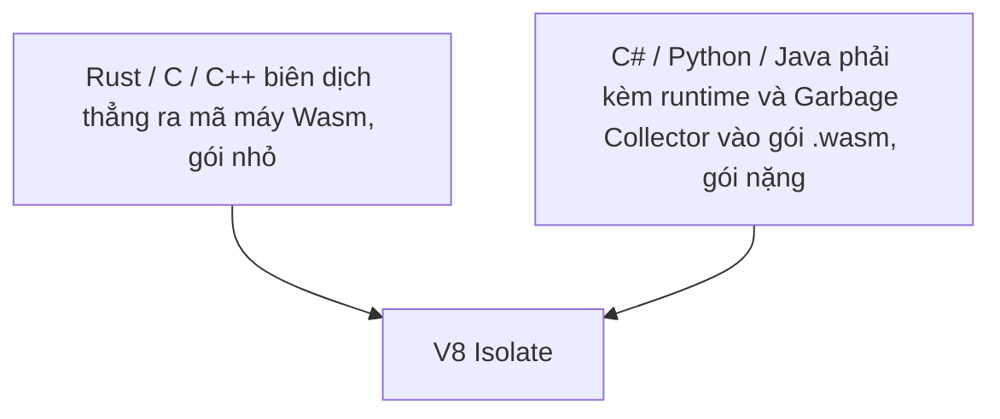
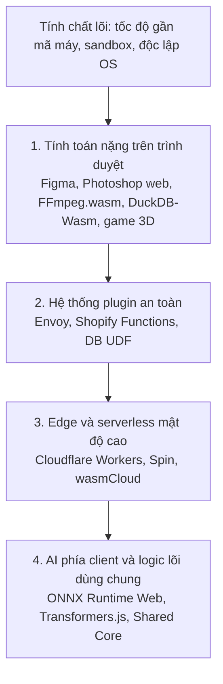
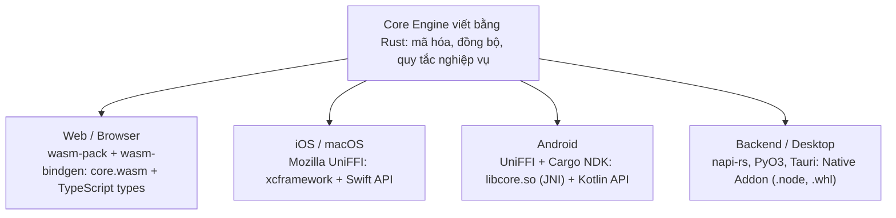

# WebAssembly: giới hạn, use case và Shared Core

WebAssembly (Wasm) là đích biên dịch (compilation target) chạy trong V8 (trình duyệt và nền tảng Edge như Cloudflare Workers). Tài liệu giải thích Wasm cho phép và không cho phép gì với các ngôn ngữ cấp cao, những use case nó phù hợp, và kiến trúc Shared Core (một lõi Rust dùng chung cho nhiều nền tảng).

Chi tiết V8 Isolate nằm ở `virtualization-stack-vmware-kvm-firecracker.md`.

## 1. Wasm cho phép gì, và giới hạn của nó với ngôn ngữ cấp cao

Wasm cho phép viết bằng Rust, C/C++, Go, C#, Java, Python rồi biên dịch ra `.wasm` để chạy trong V8. Nhưng chạy một ứng dụng C#, Java hay Python trong V8 Isolate không thay thế được môi trường Linux thực thụ, vì ba rào cản.

| Rào cản | Chi tiết |
|---|---|
| Phải nhúng runtime và GC | Rust, C, C++ dịch thẳng ra mã Wasm nhỏ. Python hay C# không tự chạy nếu thiếu trình thông dịch (CPython) hoặc bộ quản lý bộ nhớ (.NET CLR), nên phải nhúng cả runtime vào `.wasm` (Pyodide cho Python, .NET WebAssembly cho C#). Chuẩn WasmGC cho phép ngôn ngữ như Java, Kotlin, Dart dùng GC của V8 để giảm dung lượng. Chrome 119 là bản hỗ trợ theo bài viết của Chrome, nhưng trang không ghi ngày phát hành. |
| Đụng trần giới hạn của V8 Isolate | Cloudflare Workers: 128 MB bộ nhớ mỗi isolate, gồm cả JavaScript heap và WebAssembly allocations. Giới hạn dung lượng nén 3 MB và 10 MB đã bị bỏ ngày 04/09/2026, nay là 64 MiB cho bundle chưa nén trên mọi gói. Workers hỗ trợ module Wasm biên dịch sẵn, có SIMD, không có threading. Python Workers chạy bằng Pyodide trong V8 isolate. |
| Không có hệ điều hành | Wasm là máy ảo tính toán thuần túy, không có sẵn socket, file, tiến trình con (fork) hay thư viện native `.so`. Module Wasm hoặc component "starts with no ambient authority and can only do what the host explicitly grants". WASI (WebAssembly System Interface) mở các cổng giao tiếp chuẩn hóa. Bản 0.2.0 ra tháng 01/2024, 0.3.0 ra ngày 11/06/2026 và 0.3.1 ngày 11/08/2026, Wasmtime 46 trở lên bật 0.3 mặc định. |

Hệ quả: không thể bê nguyên một ứng dụng ASP.NET Core (kết nối database qua TCP truyền thống) hay một ứng dụng Python dùng Pandas, NumPy, OpenCV vào V8 Isolate mà không viết lại phần lớn tầng hạ tầng.

Con số "gói .wasm 15-30 MB" trong nguồn gốc không có nguồn chính thức. Tài liệu Pyodide chỉ nói toàn bộ distribution là "200+ megabytes" (không nêu kích thước `pyodide-core`). Microsoft Learn không đưa kích thước tải về của Blazor, đo từ bên thứ ba cho thấy một ứng dụng Blazor WASM nhỏ trên .NET 10 khoảng 2,25 MB nén Brotli, ứng dụng điển hình 2-4 MB, và AOT làm tăng kích thước.

Thực tế triển khai: Wasm trên V8 hiếm khi gánh cả backend hoàn chỉnh viết bằng Java, C# hay Python. Kỹ sư thường dùng Rust, C++ hay Go biên dịch các module tính toán nặng (nén ảnh, mã hóa, phân tích cú pháp, xác thực phức tạp) thành `.wasm` nhỏ gọn chạy cạnh JavaScript ở lớp biên, còn backend truyền thống đặt trên Firecracker MicroVM hoặc container có nhân Linux đầy đủ. Đây là nhận định kiến trúc.

## 2. Use case phù hợp

Wasm tỏa sáng khi hội tụ ba yếu tố: tốc độ gần mã máy (CPU-bound), cách ly bảo mật nghiêm ngặt (sandbox) và chạy đồng nhất trên nhiều nền tảng (portability).

### 2.1 Đồ họa, đa phương tiện và dữ liệu ngay trên trình duyệt

| Dự án | Tình trạng đã kiểm chứng |
|---|---|
| Figma | Engine dựng hình viết bằng C++, ban đầu biên dịch sang asm.js rồi chuyển sang Wasm, giảm thời gian tải hơn 3 lần. Bài viết từ 2017, không phải mô tả hiện trạng đầy đủ. |
| Photoshop trên web | Có: web.dev ghi WebAssembly và toolchain C++ Emscripten là chìa khóa đưa Photoshop lên web. |
| AutoCAD trên web | Chỉ có nguồn thứ cấp (bài blog Autodesk Google I/O 2018 không truy cập được). Chưa xác nhận chính thức. |
| FFmpeg.wasm | Có: bản port thuần WebAssembly/JavaScript của FFmpeg. CapCut Web và Descript trong nguồn gốc chưa được kiểm chứng. |
| DuckDB-Wasm | Có: chạy đầy đủ engine DuckDB trong trình duyệt và truy vấn Parquet từ xa bằng cách chỉ đọc các byte cần thiết. |
| Unity | Có: nền tảng Web dùng HTML5, JavaScript, WebAssembly, WebGL. |
| Godot | Có, kèm lưu ý: cần WebAssembly và WebGL 2.0, và dự án viết bằng C# trên Godot 4 hiện chưa xuất ra web được. |
| Unreal Engine | HTML5 đã bị gỡ khỏi lõi engine từ UE 4.24 và chuyển sang phần mở rộng do cộng đồng duy trì, gần như bị bỏ rơi. UE5 không có web target chính thức. Theo ghi chú phát hành của Epic (qua tìm kiếm, chưa mở được trang), UE 5.9 Preview 1 (09/11/2026) thêm target WebAssembly thử nghiệm kèm WebGPU, cần build từ source và dự án C++. Nên "đã bị gỡ" đúng về lịch sử nhưng đã lỗi thời. |

### 2.2 Hệ thống plugin an toàn (chạy mã không đáng tin)

Khi cho bên thứ ba viết code mở rộng, chạy thẳng trong tiến trình chính dễ làm sập hệ thống hoặc lộ dữ liệu, còn mỗi plugin một Docker container thì quá nặng. Wasm giải bài toán này:

- **Shopify Functions:** chủ shop viết logic giảm giá, phí vận chuyển bằng Rust hoặc JavaScript, biên dịch thành `.wasm`. Giới hạn chính thức không phải "dưới 5 ms" như nguồn gốc nói mà là số lệnh: tối đa 11 triệu lệnh cho giỏ hàng đến 200 dòng, tỷ lệ theo kích thước giỏ. Các giới hạn khác: binary 256 KiB, bộ nhớ tuyến tính 10 MiB, stack 512 kB. Shopify khuyến nghị Rust, và yêu cầu Wasm cho phép "any language that can compile a WebAssembly module".
- **Envoy Proxy và Istio:** Envoy chạy Wasm plugin theo chuẩn Proxy-Wasm (khuyến nghị ABI 0.2.1, runtime V8, WAMR hoặc Wasmtime, có thêm "Null VM"). Istio 1.30 (05/2026) thêm API `TrafficExtension` ở mức alpha, "supersedes WasmPlugin" như API mở rộng được khuyến nghị. Các `WasmPlugin` hiện có vẫn tương thích hoàn toàn và được Istio tự chuyển nội bộ. Không có việc bắt buộc migrate hay deprecate chính thức, và chưa thấy deprecate EnvoyFilter ở các trang đã đọc.
- **Hàm tự định nghĩa trong database (UDF):** SingleStore có Code Engine tạo UDF, UDAF, TVF từ Wasm (không có system call, file, socket, hỗ trợ C/C++ và Rust). SurrealDB quảng bá "write custom extensions in Rust, compile them to WebAssembly, and load them into SurrealDB at runtime". TiDB: không thấy hỗ trợ trong tài liệu lõi hiện tại. Một bài blog PingCAP 2021 mô tả engine Wasm UDF thử nghiệm mà chưa xác nhận từng được phát hành, và sản phẩm riêng TiDB Cloud Lake có Wasm scalar UDF. Nên coi TiDB lõi là chưa được xác nhận.

### 2.3 Edge computing và serverless mật độ cao

- Middleware tốc độ cao trên Cloudflare Workers hoặc Fastly Compute: tối ưu ảnh động, kiểm tra chữ ký JWT/HMAC, lọc bot, định tuyến A/B. Cloudflare Workers hỗ trợ module Wasm biên dịch sẵn. Fastly Compute chưa được kiểm chứng.
- **Fermyon Spin** xây ứng dụng event-driven từ Wasm component và thuộc CNCF. **wasmCloud** chạy Wasm component và có "built-in support for WASI interfaces". Akamai công bố mua Fermyon ngày 01/12/2025 và cam kết tiếp tục hỗ trợ các dự án CNCF Spin và SpinKube.

### 2.4 AI phía client

Kết hợp Wasm với WebGPU, các thư viện chạy mô hình ngay trên trình duyệt:

- **ONNX Runtime Web:** `wasm` cho CPU, `webgl`, `webgpu` hoặc `webnn` cho GPU.
- **Transformers.js:** "Run Transformers directly in your browser, with no need for a server", dùng ONNX Runtime, mặc định chạy CPU qua Wasm, tùy chọn `device: 'webgpu'`.
- **MediaPipe:** bảng thiết lập liệt kê Web với "WebGL, WebAssembly and WebGPU".

Lợi ích: dữ liệu nhạy cảm không rời máy người dùng và doanh nghiệp không tốn chi phí thuê GPU server. Dùng Whisper hay LLM nhỏ trên trình duyệt là khả thi về nguyên lý, nhưng hiệu năng cụ thể phụ thuộc thiết bị và mô hình, chưa có số liệu kiểm chứng.

### 2.5 Khi nào KHÔNG nên dùng Wasm

- **Ứng dụng web CRUD thông thường:** gọi API, xử lý JSON đơn giản và cập nhật DOM thì JavaScript thuần trên V8 (JIT) đã nhanh và gọn hơn. Wasm không truy cập DOM trực tiếp: MDN ghi "cannot currently directly access the DOM; it can only call JavaScript", và Wasm "is not intended as a replacement" cho JS.
- **Chi phí qua biên giới JS-Wasm:** hướng dẫn của Chrome cảnh báo gọi một hàm Wasm cho từng pixel, từng mẫu âm thanh hay từng vertex phát sinh overhead qua biên giới và triệt tiêu lợi thế tốc độ. Cách đúng là gom cả buffer trong một lần gọi. Chi phí gọi thuần đã giảm so với 2018 nhưng công việc nặng DOM vẫn tốn phần glue code JS.
- **Backend phụ thuộc nhiều vào I/O và OS:** nhiều kết nối TCP thô, thao tác sâu với hệ thống file Linux hoặc thư viện C++ gắn chặt OS thì nên dùng container hoặc Firecracker MicroVM.

## 3. Kiến trúc "Shared Core, Native UI"

Thay vì React Native hay Flutter ép giao diện mọi nền tảng giống nhau, từng nền tảng tự xây giao diện bằng công cụ bản địa (SwiftUI cho iOS, Jetpack Compose cho Android, React hoặc Vue cho Web), còn phần "chất xám" xử lý dữ liệu được gom vào một thư viện lõi duy nhất.

### Vì sao Rust cộng Wasm?

Đây là lập luận thiết kế, không phải sự kiện có nguồn:

- **Không có Garbage Collector:** V8, JVM/ART và ARC của iOS đều có cơ chế quản lý bộ nhớ riêng. Lõi viết bằng Go hay Java mang theo GC xung đột với GC của nền tảng chủ. Rust quản lý bộ nhớ lúc biên dịch.
- **Hỗ trợ Wasm hạng nhất:** `wasm-pack` và `wasm-bindgen` dịch struct và hàm Rust thành module `.wasm` và sinh sẵn glue JavaScript cùng kiểu TypeScript.
- **Tương thích C-ABI:** Rust xuất thư viện tĩnh hoặc động chuẩn C để iOS và Android gọi qua FFI (Foreign Function Interface).

### Lớp cầu nối

| Nền tảng | Công cụ | Ghi chú đã kiểm chứng |
|---|---|---|
| Web | wasm-bindgen | "Automatically generating TypeScript bindings for Rust code being consumed by JS". |
| iOS, Android | Mozilla UniFFI | "Full support for Kotlin, Swift and Python", có thêm binding Ruby. Đọc định nghĩa giao diện và tự sinh mã Swift và Kotlin. |
| Node.js | napi-rs | "Building pre-compiled Node.js addons in Rust". |
| Python | PyO3 | "Rust bindings for Python, including tools for creating native Python extension modules". |

### Ai áp dụng thật sự?

| Công ty | Kết quả kiểm chứng |
|---|---|
| 1Password | Đúng: "We use Rust at the core of all our client applications, including the browser extension through WASM". Trên desktop dùng Rust native. |
| Linear | Nguồn gốc nói Linear dùng lõi Rust biên dịch ra Wasm với CRDT cho sync engine. Điều này không có căn cứ. Sync engine của Linear viết bằng TypeScript với MobX và IndexedDB, dùng `lastSyncId` do server gán để có thứ tự toàn cục và giải quyết xung đột theo last-writer-wins. Một bài phân tích kỹ thuật ngược cho rằng mô hình gần với OT hơn CRDT và CTO của Linear gọi bài đó là "pretty awesome (and correct)". Một số nguồn thứ cấp nói CRDT (Yjs, ProseMirror) chỉ dùng cho soạn thảo mô tả issue, chưa xác nhận từ nguồn chính. |
| Rive | Renderer và runtime viết bằng C++, runtime web biên dịch lõi C++ này sang Wasm (rive-wasm). Không thấy việc viết lại bằng Rust. |
| Dropbox | Từng chia sẻ mã C++ cho mobile rồi bỏ: "In the end we no longer share mobile code via C++ (or any other non-standard way)" (bài 2019). |

### Đánh đổi kỹ thuật

- **Chi phí tuần tự hóa qua biên giới ngôn ngữ (FFI):** dữ liệu đi từ JavaScript vào Wasm (hay từ Kotlin/Swift vào Rust) phải sao chép hoặc đổi định dạng. Kiến trúc này hiệu quả khi đẩy một khối dữ liệu sang lõi để xử lý nặng bên trong rồi trả kết quả gọn, không hiệu quả khi gọi liên tục hàng nghìn hàm nhỏ với JSON lớn.
- **Quy trình build và CI/CD phức tạp hơn:** phải biên dịch chéo nhiều kiến trúc (`wasm32`, `arm64-apple-ios`, `aarch64-linux-android`, `x86_64`), và debug xuyên ranh giới TypeScript/Swift/Kotlin với Rust đòi hỏi trình độ cao.
- **Không phù hợp ứng dụng CRUD thông thường:** nếu chỉ gọi REST/GraphQL và hiển thị, không có thuật toán nặng, lưu trữ offline hay mã hóa đặc thù ở client thì thêm lõi Rust cộng Wasm là phức tạp không cần thiết.

## Kiểm chứng

Đối chiếu với nguồn chính thức, ngày 2026-11-18.

| Điểm | Kết quả | Nguồn |
|---|---|---|
| WasmGC: GC của ngôn ngữ không cần đi kèm bản port | Đúng. Trang không ghi ngày phát hành Chrome 119 và đã cũ về tình trạng Kotlin/Dart. | [Chrome Developers](https://developer.chrome.com/blog/wasmgc#:~:text=the%20programming%20language's%20garbage%20collector%20no%20longer%20needs%20to%20be%20part%20of%20the%20port) |
| WASI: lộ trình, bản 0.3.0 | Đúng. | [WASI roadmap](https://wasi.dev/roadmap#:~:text=WASI%200.3.0%20was%20an%20exception%20to%20the%20release%20train) |
| WASI sandbox không có ambient authority | Đúng. | [wasi.dev](https://wasi.dev/) (fragment unverified) |
| Pyodide: distribution đầy đủ 200+ MB | Đúng. | [Pyodide docs](https://pyodide.org/en/stable/usage/downloading-and-deploying.html#:~:text=The%20full%20distribution%20is%20quite%20large) |
| Blazor tải .NET runtime và assemblies | Đúng, không nêu kích thước. | [Microsoft Learn](https://learn.microsoft.com/en-us/aspnet/core/blazor/host-and-deploy/webassembly/bundle-caching-and-integrity-check-failures) (fragment unverified) |
| Cloudflare bỏ giới hạn dung lượng nén, nay 64 MiB chưa nén | Đúng, 04/09/2026. | [Cloudflare changelog](https://developers.cloudflare.com/changelog/post/2026-09-04-increased-worker-size-limit/#:~:text=Cloudflare%20now%20only%20checks%20the%20uncompressed%20size%20of%20your%20bundle) |
| Python Workers chạy bằng Pyodide trong V8 isolate | Đúng. | [Cloudflare docs](https://developers.cloudflare.com/workers/languages/python/how-python-workers-work/#:~:text=Workers%20written%20in%20Python%20are%20executed%20by%20Pyodide) |
| Figma: Wasm giảm thời gian tải hơn 3 lần | Đúng (bài 2017). | [Figma blog](https://www.figma.com/blog/webassembly-cut-figmas-load-time-by-3x/#:~:text=more%20than%203x) |
| Photoshop web dùng WebAssembly và Emscripten | Đúng. | [web.dev](https://web.dev/articles/ps-on-the-web#:~:text=WebAssembly%20and%20its%20C%2B%2B%20toolchain%20Emscripten) |
| AutoCAD web dùng Wasm | Chưa xác nhận chính thức. | [Autodesk](https://www.autodesk.com/blogs/autocad/autocad-web-app-google-io-2018/) (fragment unverified, không truy cập được) |
| Godot: dự án C# trên Godot 4 chưa xuất ra web | Đúng. | [Godot docs](https://docs.godotengine.org/en/stable/tutorials/export/exporting_for_web.html#:~:text=Projects%20written%20in%20C%23%20using%20Godot%204) |
| Unreal 5.9 Preview thêm target WebAssembly | Chưa xác minh, trang ghi chú phát hành bị lỗi chứng chỉ. | [Epic](https://dev.epicgames.com/documentation/unreal-engine/unreal-engine-5-9-release-notes) (fragment unverified) |
| Shopify Functions giới hạn 11 triệu lệnh | Đúng, nguồn gốc nói sai về "5 ms". | [Shopify](https://shopify.dev/docs/apps/build/functions/optimize-instruction-counts#:~:text=a%20function%20can%20execute%20up%20to%2011%20million%20instructions) |
| Envoy hỗ trợ Wasm plugin | Đúng. | [Envoy docs](https://www.envoyproxy.io/docs/envoy/latest/intro/arch_overview/advanced/wasm#:~:text=Envoy%20supports%20execution%20of%20Wasm%20plugins) |
| Istio TrafficExtension thay thế WasmPlugin | Đúng, alpha. | [Istio blog](https://istio.io/latest/blog/2026/traffic-extension-api/#:~:text=supersedes%20WasmPlugin) |
| SingleStore Code Engine hỗ trợ Wasm UDF | Đúng. | [SingleStore docs](https://docs.singlestore.com/cloud/reference/code-engine-powered-by-wasm/#:~:text=supports%20creating%20functions) |
| SurrealDB nạp extension Wasm lúc chạy | Đúng (theo trang quảng bá). | [SurrealDB](https://surrealdb.com/features#:~:text=Write%20custom%20extensions%20in%20Rust) |
| TiDB Cloud Lake có Wasm UDF | Đúng, đây là sản phẩm khác TiDB lõi. | [PingCAP docs](https://docs.pingcap.com/tidbcloudlake/choose-a-udf-type/) (fragment unverified) |
| Spin dùng Wasm component | Đúng. | [Spin](https://spinframework.dev/v3/index) (fragment unverified) |
| Akamai mua Fermyon, 01/12/2025 | Đúng, lấy từ bản tóm tắt kết quả tìm kiếm. | [GlobeNewswire](https://www.globenewswire.com/news-release/2025/12/01/3196978/0/en/Akamai-Technologies-Announces-Acquisition-of-Function-as-a-Service-Company-Fermyon.html) (fragment unverified) |
| 1Password dùng Rust cho lõi và Wasm cho extension | Đúng. | [1Password blog](https://1password.com/blog/passkey-crates#:~:text=including%20the%20browser%20extension%20through%20WASM) |
| Sync engine của Linear là TypeScript, không phải Rust/Wasm | Phân tích ngược, mức tin cậy trung bình. | [reverse-linear-sync-engine](https://github.com/wzhudev/reverse-linear-sync-engine#:~:text=Linear's%20collaboration%20model%20aligns%20more%20closely%20with%20OT) |
| Dropbox bỏ chia sẻ mã mobile bằng C++ | Đúng (bài 2019). | [Dropbox Tech](https://dropbox.tech/mobile/the-not-so-hidden-cost-of-sharing-code-between-ios-and-android#:~:text=we%20no%20longer%20share%20mobile%20code%20via%20C%2B%2B) |
| Rive: runtime C++ biên dịch sang Wasm | Gián tiếp. | [rive-runtime](https://github.com/rive-app/rive-runtime) (fragment unverified) |
| UniFFI hỗ trợ Kotlin, Swift, Python | Đúng. | [UniFFI](https://mozilla.github.io/uniffi-rs/latest/#:~:text=UniFFI%20comes%20with%20full%20support%20for%20Kotlin%2C%20Swift%20and%20Python) |
| wasm-bindgen sinh TypeScript bindings | Đúng. | [wasm-bindgen](https://rustwasm.github.io/docs/wasm-bindgen/#:~:text=Automatically%20generating%20TypeScript%20bindings) |
| napi-rs, PyO3 | Đúng. | [napi-rs](https://napi.rs/#:~:text=Building%20pre%2Dcompiled%20Node.js%20addons%20in%20Rust), [PyO3](https://pyo3.rs/#:~:text=Rust%20bindings%20for%20Python) |
| ONNX Runtime Web | Đúng. | [ONNX Runtime](https://onnxruntime.ai/docs/tutorials/web/#:~:text=WebAssembly%20(%60wasm%60%2C%20alias%20to%20%60cpu%60)) |
| Transformers.js chạy trong trình duyệt | Đúng. | [Hugging Face](https://huggingface.co/docs/transformers.js/index#:~:text=with%20no%20need%20for%20a%20server) |
| MediaPipe hỗ trợ Web | Đúng. | [Google](https://developers.google.com/edge/mediapipe/solutions/guide) (fragment unverified) |
| Chi phí qua biên giới JS-Wasm | Đúng. | [Chrome](https://developer.chrome.com/docs/modern-web-guidance/guides/wasm/cpp-on-the-web#:~:text=Calling%20an%20exported%20Wasm%20function%20per%20pixel), [MDN](https://developer.mozilla.org/en-US/docs/WebAssembly/Guides/Concepts#:~:text=cannot%20currently%20directly%20access%20the%20DOM) |

Chưa xác minh được:

- Lõi Rust, Wasm và CRDT của Linear: bị bác ở trên, nhưng chưa có trang chính thức của Linear xác nhận hay phủ nhận.
- Con số kích thước gói 15-30 MB, CapCut Web, Descript, và Fastly Compute.
- Các bản Unreal mới nhất hỗ trợ Wasm.
- Lập luận "vì sao Rust + Wasm" (không GC, hỗ trợ hạng nhất, C-ABI) là phân tích thiết kế, không có nguồn trực tiếp.
